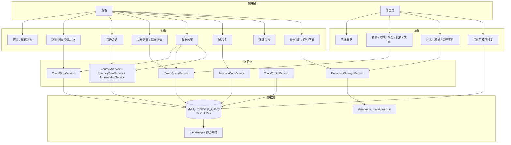
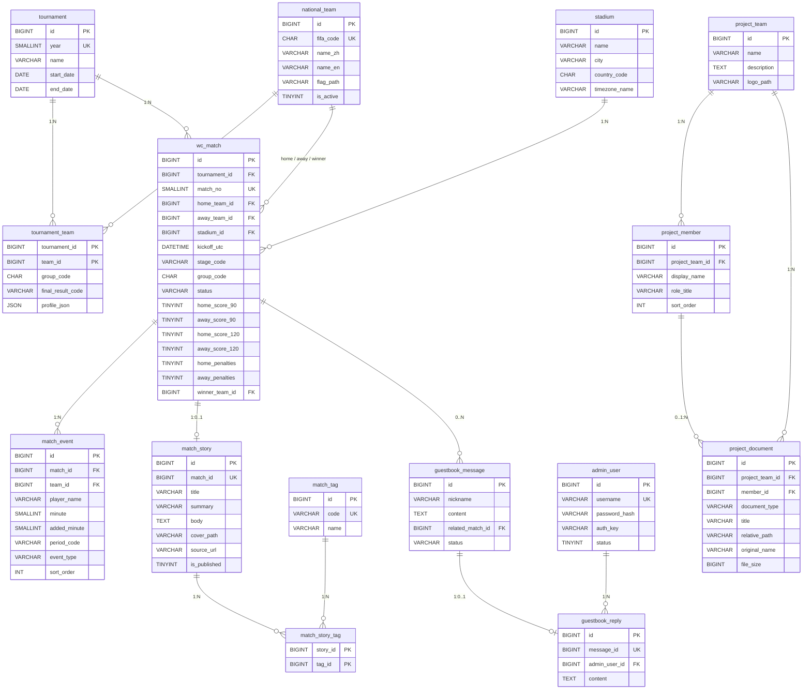
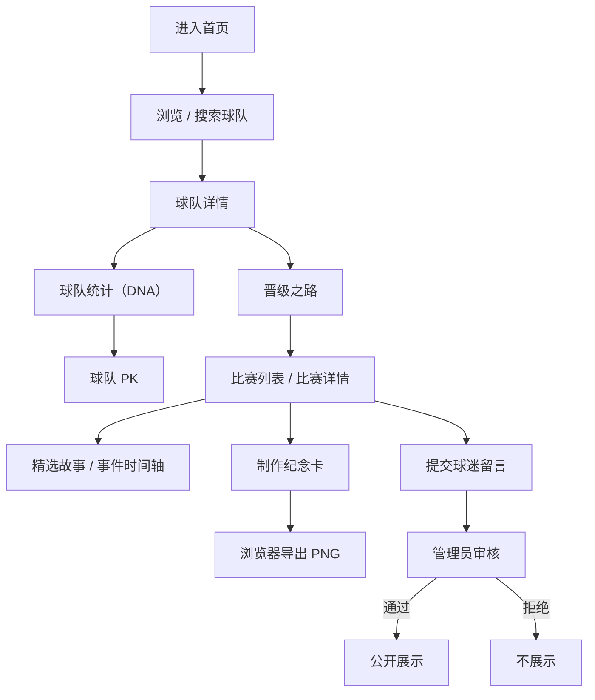
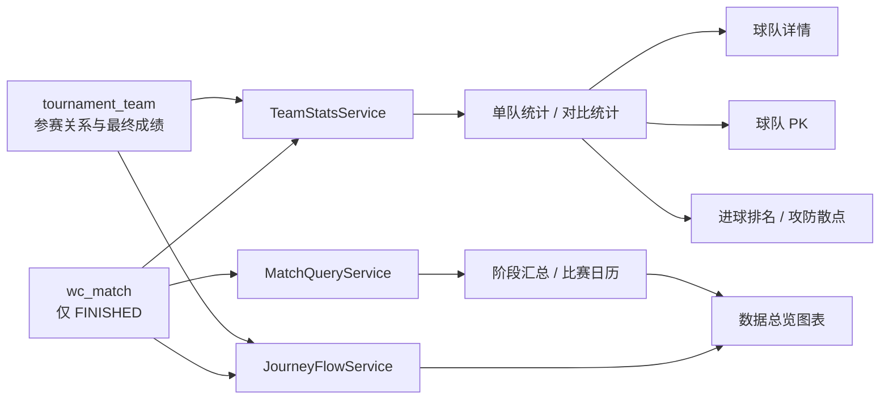
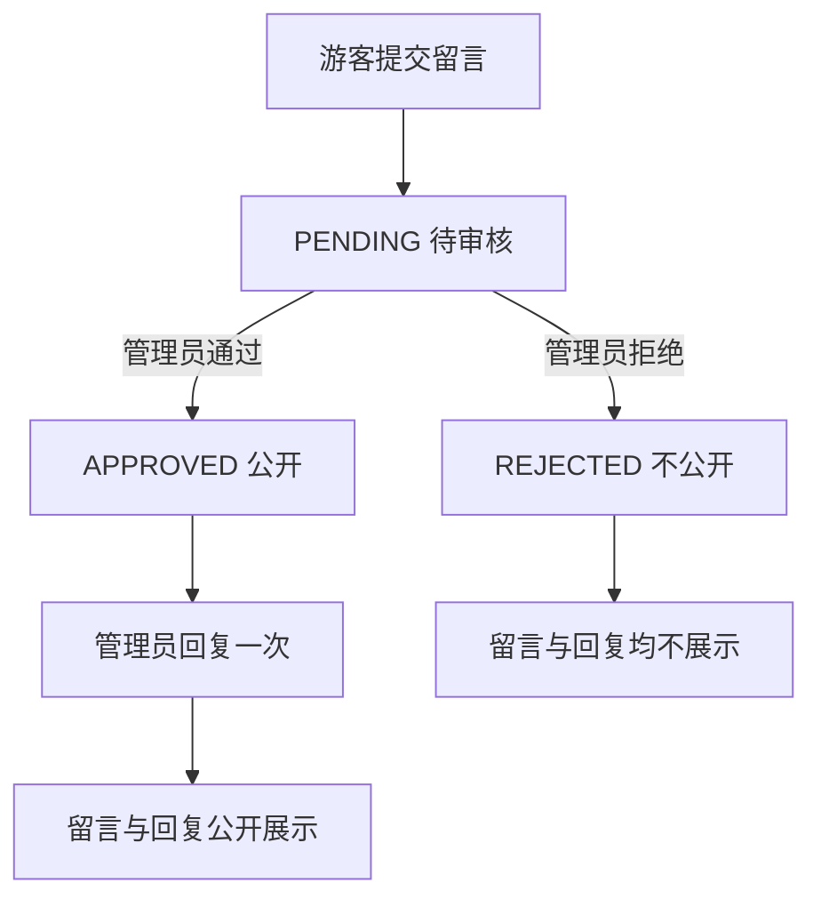

# WorldCup Journey 项目设计文档

**课程**　互联网数据库开发
**团队**　WorldCup Journey 开发小组
**项目**　2026 世界杯数据探索与记忆平台

| 成员 | 学号 |
| --- | --- |
| 卢苑 | 2413275 |
| 胡乐妍 | 2413272 |
| 袁颢心 | 2411539 |
| 张馨月 | 2414029 |

## 1. 系统模块设计

### 1.1 系统模块图



### 1.2 模块职责

| 模块 | 模块职责 | 核心类/服务 | 主要数据 |
| --- | --- | --- | --- |
| 公共界面与首页 | 首页、球队搜索入口、公共导航 | `SiteController`、布局与公共导航 | 球队、比赛计数 |
| 球队与统计 | 球队列表、详情、统计与 PK | `NationalTeamController`、`TeamStatsService`、`NationalTeam`、`TournamentTeam` | 球队、参赛关系、比赛 |
| 晋级之路 | 按球队查看比赛历程和场馆路线 | `JourneyController`、`JourneyService`、`JourneyFlowService`、`JourneyMapService` | 比赛、球队、场馆 |
| 比赛与故事 | 赛程筛选、比赛详情、故事与事件 | `WcMatchController`、`MatchQueryService`、`MatchMomentumService` | 比赛、故事、事件、标签 |
| 数据总览 | 晋级流向、进球排名、攻防散点、比赛日历 | `InsightController`、ECharts 前端脚本 | 统计、阶段汇总、晋级流向、日历 |
| 纪念卡 | 选择球队和比赛，在浏览器生成 PNG | `MemoryController`、`MemoryCardService`、`memory-card.js` | 球队、比赛、可选统计 |
| 留言与认证 | 留言提交、管理员登录 | `GuestbookController`、`AuthController`、`AdminUser` | 留言、回复、管理员 |
| 团队与作业 | 团队介绍、成员作业下载 | `ProjectTeamController`、`DocumentController`、`DocumentStorageService` | 团队、成员、课程文件 |
| 管理后台 | 维护赛事、球队、场馆、比赛、故事、课程资料和留言 | 八个后台控制器 | 全部业务表 |
| 只读统计接口 | 向图表和页面提供球队统计、对比、阶段汇总、晋级流向 | `ApiController` | 统计与汇总结果 |

## 2. 数据库设计

### 2.1 设计目标

1. 用一个数据库 `worldcup_journey` 存储赛事、球队、比赛、内容和课程资料。
2. 用外键和唯一键表达真实关系，不用名称或页面文案代替主键。
3. 让统计可以从比赛结果重复计算，避免统计表与比赛表出现冲突。
4. 让历史数据可以被保留，无论是球队停用、故事未发布、比赛取消都不破坏已有关联。

数据库统一使用 InnoDB、`utf8mb4`、`utf8mb4_0900_ai_ci`；时间按 UTC 存储，页面按北京时间显示。

### 2.2 数据模型总览

| 表 | 作用 |
| --- | --- |
| `tournament` | 赛事届次 |
| `national_team` | 国家队基础资料 |
| `tournament_team` | 球队参加某届赛事的关系、分组、最终成绩、球队档案 |
| `stadium` | 比赛场馆 |
| `wc_match` | 比赛赛程与结果 |
| `match_event` | 精选比赛事件时间轴 |
| `match_story` | 精选比赛故事 |
| `match_tag` | 故事标签字典 |
| `match_story_tag` | 故事与标签的多对多关系 |
| `project_team` | 课程团队资料 |
| `project_member` | 团队成员与分工 |
| `project_document` | 团队与个人作业文件数据 |
| `admin_user` | 管理员账号 |
| `guestbook_message` | 游客留言与审核状态 |
| `guestbook_reply` | 管理员回复 |

### 2.3 ER 图

下图中仅列出关键字段，完整字段和约束写在 `2.9数据字典` 中。PK、FK、UK分别表示主键、外键、唯一键。



### 2.4 核心设计

#### 2.4.1 赛事与球队

| 表 | 关键设计 | 为什么这样设计 |
| --- | --- | --- |
| `tournament` | `year` 唯一，日期用 `DATE`；`CHECK` 保证年份为正、开始不晚于结束 | 赛事以年份定位，不直接定义 `id=1`，方便随时增加其他届次 |
| `national_team` | `fifa_code` 唯一，`name_zh`、`name_en` 分列，`is_active` 控制前台可见性 | FIFA 代码是导入映射键，在停用球队时仍能解析历史比赛 |
| `tournament_team` | 联合主键 `(tournament_id, team_id)`，保存 `group_code`、`final_result_code`、`profile_json` | 一张表同时储存参赛关系和本届档案，不把参赛资格藏在球队表 |

#### 2.4.2 场馆与比赛

| 表 | 关键设计 | 为什么这样设计 |
| --- | --- | --- |
| `stadium` | 不设 `UNIQUE(name)`，`country_code` 限制为 `CA/MX/US`，`timezone_name` 可以为空 | 因为场馆名可能重复或调整，只能用内部ID作为稳定键，时区用于本地化展示 |
| `wc_match` | 90 分钟、120 分钟、点球三组比分做出区分，`winner_team_id` 独立，大量 `CHECK` | 加时比分是累计值，不能与 90 分钟相加，点球不计入总进球，详尽的约束可以把多数错误挡在数据库层 |

`wc_match` 中的关键约束如下：

- 阶段、状态、小组代码使用固定枚举。
- 90 分钟比分必须成对；120 分钟比分必须成对，且以 90 分钟存在为前提、数值不小于 90 分钟。
- 点球比分必须成对且分出胜负；点球胜者必须与 `winner_team_id` 一致。
- `FINISHED` 必须有 90 分钟比分；未开始、延期、取消不得有赛果。
- 已结束的淘汰赛/季军赛/决赛必须有胜者；小组赛不得有点球或 `winner_team_id`。
- 无点球时，淘汰赛胜者必须与最终场上比分一致。

除了以上约束之外，一些跨表规则（例如“主客队都属于该届赛事”“事件球队属于本场双方”等）由导入程序、Model 和 Service 保证，不包含在 `CHECK` 中。

#### 2.4.3 比赛内容

| 表 | 关键设计 | 为什么这样设计 |
| --- | --- | --- |
| `match_event` | `match_id` 必填，`team_id` 可空，`period_code`、`event_type` 固定枚举，`sort_order` 稳定排序 | 事件只用于时间轴和比分走势，不作为球队进球统计来源 |
| `match_story` | `match_id` 唯一，`is_published` 控制前台可见 | 一场比赛最多一篇故事，未发布的故事不返回正文、事件和标签 |
| `match_tag` | `code` 唯一，`name` 不唯一 | 标签应该用稳定代码关联，而显示名可以随时调整 |
| `match_story_tag` | 联合主键，`story_id` 删除时 `CASCADE`，`tag_id` 删除时 `RESTRICT` | 删除故事时清理关联，删除标签前必须先处理引用，禁止反向删除比赛 |

### 2.5 辅助设计

#### 2.5.1 课程团队与作业

| 表 | 关键设计 | 为什么这样设计 |
| --- | --- | --- |
| `project_team` | 团队名称、简介、Logo 路径 | 团队资料用表维护，便于后台直接修改 |
| `project_member` | 外键指向团队，`sort_order` 控制展示顺序 | 成员必须属于一个团队，顺序可调整 |
| `project_document` | `document_type` 为 `TEAM/PERSONAL`，`member_id` 可空，保存相对路径、原文件名、大小 | 团队作业不绑定成员，个人作业必须绑定成员，文件实体放在 `data/` 下，数据库保存文件本身的数据 |

#### 2.5.2 管理员与留言

| 表 | 关键设计 | 为什么这样设计 |
| --- | --- | --- |
| `admin_user` | `username` 唯一，存储 `password_hash`，`status` 控制启停 | 不直接保存明文密码，已经停用的账号不能登录 |
| `guestbook_message` | `status` 为 `PENDING/APPROVED/REJECTED`，`related_match_id` 可空 | 新留言默认待审，可以关联比赛，也可以不关联 |
| `guestbook_reply` | `message_id` 唯一，`admin_user_id` 必填 | 首版一条留言最多一条回复；回复必须记录管理员 |

### 2.6 关系与主外键

| 关系 | 基数 | 说明 |
| --- | --- | --- |
| `tournament` → `tournament_team` | 1:N | 一届赛事有多条参赛关系 |
| `national_team` → `tournament_team` | 1:N | 球队可以参加多届，每届一条 |
| `tournament` → `wc_match` | 1:N | 每场比赛属于一届赛事 |
| `stadium` → `wc_match` | 1:N | 每场比赛有一个场馆 |
| `national_team` → `wc_match` | 1:N（三种角色） | 主队、客队、胜方是三个不同外键，不能混用 |
| `wc_match` → `match_event` | 1:N | 一场比赛多条事件 |
| `wc_match` → `match_story` | 1:0..1 | 一场比赛最多一篇故事 |
| `match_story` → `match_story_tag` | 1:N | 一篇故事多个标签 |
| `match_tag` → `match_story_tag` | 1:N | 一个标签可用于多篇故事 |
| `project_team` → `project_member` | 1:N | 一个团队多名成员 |
| `project_team` → `project_document` | 1:N | 团队有多份课程文件 |
| `project_member` → `project_document` | 0..1:N | 个人作业绑定成员，团队作业不绑定成员 |
| `wc_match` → `guestbook_message` | 0..N | 留言可选关联比赛 |
| `guestbook_message` → `guestbook_reply` | 1:0..1 | 一条留言最多一条回复 |
| `admin_user` → `guestbook_reply` | 1:N | 一个管理员可回复多条留言 |

### 2.7 主键、唯一键、索引与空值

#### 2.7.1 主键与唯一键

| 表 | 主键 | 唯一键 |
| --- | --- | --- |
| `tournament` | `id` | `year` |
| `national_team` | `id` | `fifa_code` |
| `tournament_team` | `(tournament_id, team_id)` | 联合主键本身 |
| `stadium` | `id` | 无 |
| `wc_match` | `id` | `(tournament_id, match_no)` |
| `match_event` | `id` | 无 |
| `match_story` | `id` | `match_id` |
| `match_tag` | `id` | `code` |
| `match_story_tag` | `(story_id, tag_id)` | 联合主键本身 |
| `project_team` | `id` | 无 |
| `project_member` | `id` | 无 |
| `project_document` | `id` | 无 |
| `admin_user` | `id` | `username` |
| `guestbook_message` | `id` | 无 |
| `guestbook_reply` | `id` | `message_id` |

#### 2.7.2 主要索引

- `national_team(name_zh)`：支持中文名搜索。
- `tournament_team(team_id, tournament_id)`：支持按球队反查参赛关系。
- `wc_match(tournament_id, kickoff_utc)`：支持按届次和时间读取赛程。
- `wc_match(home_team_id)`、`wc_match(away_team_id)`、`wc_match(stage_code)`、`wc_match(stadium_id)`、`wc_match(winner_team_id)`：支持球队、阶段、场馆和胜方查询。
- `match_event(match_id, sort_order)`：支持时间轴稳定排序。
- `guestbook_message(status, created_at)`：支持后台按状态和时间审核。

#### 2.7.3 空值

- 可空列用 `NULL` 表示“没有”，真实的 `0` 保留。
- `wc_match` 未开始的比分、点球、胜者均为 `NULL`，`FINISHED` 至少要求 90 分钟比分非空。
- `match_story.cover_path`、`national_team.flag_path` 允许为空，页面使用占位或回退。

### 2.8 枚举与状态字典

| 对象 | 取值 | 说明 |
| --- | --- | --- |
| `wc_match.stage_code` | `GROUP/R32/R16/QF/SF/THIRD/FINAL` | 小组赛到决赛 |
| `wc_match.status` | `SCHEDULED/IN_PROGRESS/FINISHED/POSTPONED/CANCELLED` | 默认为 `SCHEDULED` |
| `wc_match.group_code` | `A 到 L` | 仅小组赛可填，其他阶段为 `NULL` |
| `match_event.period_code` | `H1/H2/ET1/ET2/SHOOTOUT` | 上/下半场、加时、点球 |
| `match_event.event_type` | `GOAL/OWN_GOAL/YELLOW/RED/PENALTY_GOAL/PENALTY_MISS/OTHER` | 事件类型 |
| `tournament_team.final_result_code` | `GROUP/R32/R16/QF/FOURTH/THIRD/RUNNER_UP/CHAMPION` | 最终成绩类别 |
| `project_document.document_type` | `TEAM/PERSONAL` | 团队作业/个人作业 |
| `guestbook_message.status` | `PENDING/APPROVED/REJECTED` | 默认为 `PENDING` |
| `admin_user.status` | `0/1` | 0 停用，1 启用 |

### 2.9 完整数据字典

以下列出 15 张表的字段、约束和说明。

#### 2.9.1 `tournament`（赛事届次）

| 字段 | 类型 | 空 | 默认 | 键/约束 | 说明 |
| --- | --- | --- | --- | --- | --- |
| `id` | BIGINT UNSIGNED | 否 | 自增 | PK | 赛事内部 ID |
| `year` | SMALLINT UNSIGNED | 否 | 无 | UQ | 赛事年份，本期 2026 |
| `name` | VARCHAR(120) | 否 | 无 |  | 赛事名称 |
| `start_date` | DATE | 否 | 无 |  | 开始日期 |
| `end_date` | DATE | 否 | 无 |  | 结束日期 |
| `description` | TEXT | 是 | NULL |  | 简介 |
| `created_at` | DATETIME | 否 | CURRENT_TIMESTAMP |  | 创建时间（UTC） |
| `updated_at` | DATETIME | 否 | CURRENT_TIMESTAMP ON UPDATE |  | 修改时间（UTC） |

#### 2.9.2 `national_team`（国家队）

| 字段 | 类型 | 空 | 默认 | 键/约束 | 说明 |
| --- | --- | --- | --- | --- | --- |
| `id` | BIGINT UNSIGNED | 否 | 自增 | PK | 球队内部 ID |
| `fifa_code` | CHAR(3) | 否 | 无 | UQ | FIFA 三字母码，导入映射键 |
| `name_zh` | VARCHAR(80) | 否 | 无 |  | 中文展示名 |
| `name_en` | VARCHAR(100) | 否 | 无 |  | 英文名 |
| `flag_path` | VARCHAR(255) | 是 | NULL |  | 相对 `web/` 的本地素材路径 |
| `description` | TEXT | 是 | NULL |  | 简介 |
| `is_active` | TINYINT(1) | 否 | 1 | CHECK | 1 启用，0 停用；停用不破坏历史关联 |
| `created_at` | DATETIME | 否 | CURRENT_TIMESTAMP |  | 创建时间（UTC） |
| `updated_at` | DATETIME | 否 | CURRENT_TIMESTAMP ON UPDATE |  | 修改时间（UTC） |

#### 2.9.3 `stadium`（比赛场馆）

| 字段 | 类型 | 空 | 默认 | 键/约束 | 说明 |
| --- | --- | --- | --- | --- | --- |
| `id` | BIGINT UNSIGNED | 否 | 自增 | PK | 场馆内部 ID |
| `name` | VARCHAR(120) | 否 | 无 |  | 官方场馆名；不设唯一键 |
| `city` | VARCHAR(100) | 否 | 无 |  | 城市 |
| `country_code` | CHAR(2) | 否 | 无 | CHECK | `CA/MX/US` |
| `timezone_name` | VARCHAR(64) | 是 | NULL |  | IANA 时区名 |
| `created_at` | DATETIME | 否 | CURRENT_TIMESTAMP |  | 创建时间（UTC） |
| `updated_at` | DATETIME | 否 | CURRENT_TIMESTAMP ON UPDATE |  | 修改时间（UTC） |

#### 2.9.4 `tournament_team`（赛事参赛关系）

| 字段 | 类型 | 空 | 默认 | 键/约束 | 说明 |
| --- | --- | --- | --- | --- | --- |
| `tournament_id` | BIGINT UNSIGNED | 否 | 无 | PK1，FK | 赛事 ID |
| `team_id` | BIGINT UNSIGNED | 否 | 无 | PK2，FK | 球队 ID |
| `group_code` | CHAR(1) | 否 | 无 | CHECK | 小组 A 到 L |
| `final_result_code` | VARCHAR(20) | 是 | NULL | CHECK | 最终成绩类别 |
| `profile_json` | JSON | 是 | NULL |  | 2026 届球队简介、教练、三位代表球员和来源快照 |
| `created_at` | DATETIME | 否 | CURRENT_TIMESTAMP |  | 创建时间（UTC） |
| `updated_at` | DATETIME | 否 | CURRENT_TIMESTAMP ON UPDATE |  | 修改时间（UTC） |

#### 2.9.5 `wc_match`（比赛）

| 字段 | 类型 | 空 | 默认 | 键/约束 | 说明 |
| --- | --- | --- | --- | --- | --- |
| `id` | BIGINT UNSIGNED | 否 | 自增 | PK | 比赛内部 ID |
| `tournament_id` | BIGINT UNSIGNED | 否 | 无 | FK | 所属赛事 |
| `match_no` | SMALLINT UNSIGNED | 否 | 无 | UQ(与赛事) | 本届比赛编号 1 到 104 |
| `home_team_id` | BIGINT UNSIGNED | 否 | 无 | FK | 主队 |
| `away_team_id` | BIGINT UNSIGNED | 否 | 无 | FK | 客队 |
| `stadium_id` | BIGINT UNSIGNED | 否 | 无 | FK | 场馆 |
| `kickoff_utc` | DATETIME | 否 | 无 |  | UTC 开赛时间 |
| `stage_code` | VARCHAR(10) | 否 | 无 | CHECK | 阶段枚举 |
| `group_code` | CHAR(1) | 是 | NULL | CHECK | 仅 GROUP 可填 A 到 L |
| `status` | VARCHAR(16) | 否 | `SCHEDULED` | CHECK | 比赛状态 |
| `home_score_90` | TINYINT UNSIGNED | 是 | NULL | CHECK | 90 分钟含补时比分 |
| `away_score_90` | TINYINT UNSIGNED | 是 | NULL | CHECK | 90 分钟含补时比分 |
| `home_score_120` | TINYINT UNSIGNED | 是 | NULL | CHECK | 含加时累计比分 |
| `away_score_120` | TINYINT UNSIGNED | 是 | NULL | CHECK | 含加时累计比分 |
| `home_penalties` | TINYINT UNSIGNED | 是 | NULL | CHECK | 点球大战命中数 |
| `away_penalties` | TINYINT UNSIGNED | 是 | NULL | CHECK | 点球大战命中数 |
| `winner_team_id` | BIGINT UNSIGNED | 是 | NULL | FK/CHECK | 淘汰赛胜方；小组赛为空 |
| `summary` | VARCHAR(300) | 是 | NULL |  | 一句话摘要，与故事正文分开 |
| `created_at` | DATETIME | 否 | CURRENT_TIMESTAMP |  | 创建时间（UTC） |
| `updated_at` | DATETIME | 否 | CURRENT_TIMESTAMP ON UPDATE |  | 修改时间（UTC） |

#### 2.9.6 `match_story`（精选比赛故事）

| 字段 | 类型 | 空 | 默认 | 键/约束 | 说明 |
| --- | --- | --- | --- | --- | --- |
| `id` | BIGINT UNSIGNED | 否 | 自增 | PK | 故事 ID |
| `match_id` | BIGINT UNSIGNED | 否 | 无 | UQ，FK | 对应比赛 |
| `title` | VARCHAR(150) | 否 | 无 |  | 标题 |
| `summary` | VARCHAR(500) | 否 | 无 |  | 摘要 |
| `body` | TEXT | 否 | 无 |  | 正文；当前按纯文本编码输出 |
| `cover_path` | VARCHAR(255) | 是 | NULL |  | 封面相对路径 |
| `source_url` | VARCHAR(600) | 是 | NULL |  | 来源 URL |
| `is_published` | TINYINT(1) | 否 | 0 | CHECK | 1 发布，0 未发布 |
| `created_at` | DATETIME | 否 | CURRENT_TIMESTAMP |  | 创建时间（UTC） |
| `updated_at` | DATETIME | 否 | CURRENT_TIMESTAMP ON UPDATE |  | 修改时间（UTC） |

#### 2.9.7 `match_tag`（故事标签）

| 字段 | 类型 | 空 | 默认 | 键/约束 | 说明 |
| --- | --- | --- | --- | --- | --- |
| `id` | BIGINT UNSIGNED | 否 | 自增 | PK | 标签 ID |
| `code` | VARCHAR(40) | 否 | 无 | UQ | 唯一英文标签代码 |
| `name` | VARCHAR(40) | 否 | 无 |  | 显示名；不设唯一键 |

#### 2.9.8 `match_story_tag`（故事与标签关联）

| 字段 | 类型 | 空 | 默认 | 键/约束 | 说明 |
| --- | --- | --- | --- | --- | --- |
| `story_id` | BIGINT UNSIGNED | 否 | 无 | PK1，FK | 故事 ID；删除故事时级联清理 |
| `tag_id` | BIGINT UNSIGNED | 否 | 无 | PK2，FK | 标签 ID；删除受引用限制 |

#### 2.9.9 `match_event`（比赛事件）

| 字段 | 类型 | 空 | 默认 | 键/约束 | 说明 |
| --- | --- | --- | --- | --- | --- |
| `id` | BIGINT UNSIGNED | 否 | 自增 | PK | 事件 ID |
| `match_id` | BIGINT UNSIGNED | 否 | 无 | FK | 所属比赛 |
| `team_id` | BIGINT UNSIGNED | 是 | NULL | FK | 可选关联球队；非空须为本场双方之一 |
| `player_name` | VARCHAR(100) | 是 | NULL |  | 球员显示名 |
| `minute` | SMALLINT UNSIGNED | 是 | NULL | CHECK | 基础分钟；非点球大战必填 |
| `added_minute` | SMALLINT UNSIGNED | 是 | NULL | CHECK | 补时分钟；无补时为 NULL |
| `period_code` | VARCHAR(12) | 否 | 无 | CHECK | 半场/加时/点球 |
| `event_type` | VARCHAR(20) | 否 | 无 | CHECK | 事件类型 |
| `description` | VARCHAR(500) | 是 | NULL |  | 事件描述 |
| `sort_order` | INT | 否 | 0 |  | 同一分钟稳定排序 |
| `created_at` | DATETIME | 否 | CURRENT_TIMESTAMP |  | 创建时间（UTC） |
| `updated_at` | DATETIME | 否 | CURRENT_TIMESTAMP ON UPDATE |  | 修改时间（UTC） |

#### 2.9.10 `project_team`（课程团队）

| 字段 | 类型 | 空 | 默认 | 键/约束 | 说明 |
| --- | --- | --- | --- | --- | --- |
| `id` | BIGINT UNSIGNED | 否 | 自增 | PK | 团队 ID |
| `name` | VARCHAR(100) | 否 | 无 |  | 团队名称 |
| `description` | TEXT | 是 | NULL |  | 团队简介 |
| `logo_path` | VARCHAR(255) | 是 | NULL |  | Logo 相对路径 |
| `updated_at` | DATETIME | 否 | CURRENT_TIMESTAMP ON UPDATE |  | 修改时间（UTC） |

#### 2.9.11 `project_member`（团队成员）

| 字段 | 类型 | 空 | 默认 | 键/约束 | 说明 |
| --- | --- | --- | --- | --- | --- |
| `id` | BIGINT UNSIGNED | 否 | 自增 | PK | 成员 ID |
| `project_team_id` | BIGINT UNSIGNED | 否 | 无 | FK | 所属团队 |
| `display_name` | VARCHAR(80) | 否 | 无 |  | 显示名 |
| `role_title` | VARCHAR(100) | 否 | 无 |  | 角色/分工 |
| `bio` | TEXT | 是 | NULL |  | 简介 |
| `sort_order` | INT | 否 | 0 |  | 展示顺序 |
| `updated_at` | DATETIME | 否 | CURRENT_TIMESTAMP ON UPDATE |  | 修改时间（UTC） |

#### 2.9.12 `project_document`（团队/个人作业文件）

| 字段 | 类型 | 空 | 默认 | 键/约束 | 说明 |
| --- | --- | --- | --- | --- | --- |
| `id` | BIGINT UNSIGNED | 否 | 自增 | PK | 文件记录 ID |
| `project_team_id` | BIGINT UNSIGNED | 否 | 无 | FK | 所属团队 |
| `member_id` | BIGINT UNSIGNED | 是 | NULL | FK/CHECK | `PERSONAL` 必填；`TEAM` 为空 |
| `document_type` | VARCHAR(10) | 否 | 无 | CHECK | `TEAM/PERSONAL` |
| `title` | VARCHAR(160) | 否 | 无 |  | 作业标题 |
| `relative_path` | VARCHAR(255) | 否 | 无 |  | 受控相对路径 |
| `original_name` | VARCHAR(255) | 否 | 无 |  | 原始文件名 |
| `file_size` | BIGINT UNSIGNED | 否 | 无 |  | 文件大小（字节） |
| `uploaded_at` | DATETIME | 否 | CURRENT_TIMESTAMP |  | 上传时间（UTC） |

#### 2.9.13 `admin_user`（管理员）

| 字段 | 类型 | 空 | 默认 | 键/约束 | 说明 |
| --- | --- | --- | --- | --- | --- |
| `id` | BIGINT UNSIGNED | 否 | 自增 | PK | 管理员 ID |
| `username` | VARCHAR(60) | 否 | 无 | UQ | 登录名 |
| `password_hash` | VARCHAR(255) | 否 | 无 |  | 哈希密码 |
| `auth_key` | VARCHAR(100) | 否 | 无 |  | 认证 key |
| `status` | TINYINT(1) | 否 | 1 | CHECK | 1 启用，0 停用 |
| `last_login_at` | DATETIME | 是 | NULL |  | 最后登录（UTC） |
| `created_at` | DATETIME | 否 | CURRENT_TIMESTAMP |  | 创建时间（UTC） |
| `updated_at` | DATETIME | 否 | CURRENT_TIMESTAMP ON UPDATE |  | 修改时间（UTC） |

#### 2.9.14 `guestbook_message`（游客留言）

| 字段 | 类型 | 空 | 默认 | 键/约束 | 说明 |
| --- | --- | --- | --- | --- | --- |
| `id` | BIGINT UNSIGNED | 否 | 自增 | PK | 留言 ID |
| `nickname` | VARCHAR(50) | 否 | 无 |  | 昵称 |
| `content` | TEXT | 否 | 无 |  | 内容；输出必须编码 |
| `related_match_id` | BIGINT UNSIGNED | 是 | NULL | FK | 可选关联比赛 |
| `status` | VARCHAR(12) | 否 | `PENDING` | CHECK | 审核状态 |
| `created_at` | DATETIME | 否 | CURRENT_TIMESTAMP |  | 创建时间（UTC） |
| `updated_at` | DATETIME | 否 | CURRENT_TIMESTAMP ON UPDATE |  | 修改时间（UTC） |

#### 2.9.15 `guestbook_reply`（管理员回复）

| 字段 | 类型 | 空 | 默认 | 键/约束 | 说明 |
| --- | --- | --- | --- | --- | --- |
| `id` | BIGINT UNSIGNED | 否 | 自增 | PK | 回复 ID |
| `message_id` | BIGINT UNSIGNED | 否 | 无 | UQ，FK | 留言 ID |
| `admin_user_id` | BIGINT UNSIGNED | 否 | 无 | FK | 回复管理员 |
| `content` | TEXT | 否 | 无 |  | 回复内容 |
| `created_at` | DATETIME | 否 | CURRENT_TIMESTAMP |  | 创建时间（UTC） |
| `updated_at` | DATETIME | 否 | CURRENT_TIMESTAMP ON UPDATE |  | 修改时间（UTC） |

### 2.10 DDL 与建表顺序

```text
tournament
national_team
stadium
tournament_team
wc_match
match_story
match_tag
match_story_tag
match_event
project_team
project_member
project_document
admin_user
guestbook_message
guestbook_reply
```

建表顺序遵循外键依赖：先建被引用表，再建引用表。重建数据库时按反向顺序删除，不能对已有真实数据的库执行任何破坏性操作。

## 3. 关键流程与统计设计

### 3.1 主流程



主流程从球队进入，经过统计、PK、晋级之路和比赛详情，最后到达纪念卡或留言审核。各步骤读取同一套赛事数据，页面负责展示。

### 3.2 统计口径与数据流

统计相关页面使用同一条数据流。



#### 3.2.1 比分与胜平负

| 项目 | 规则 |
| --- | --- |
| 最终场上比分 | `home_score_120` 非空取 120 分钟值，否则取 `home_score_90`；加时比分是累计值，不再与 90 分钟相加 |
| 点球 | `home_penalties`、`away_penalties` 单独记录，不计入总进球 |
| 胜平负 | 比较最终场上比分；点球大战前场上战平计为平局，点球胜场单独统计 |
| 未完成比赛 | `SCHEDULED/IN_PROGRESS/POSTPONED/CANCELLED` 不进入球队统计 |

#### 3.2.2 球队统计字段

| 字段 | 计算规则 |
| --- | --- |
| `matches_played` | 该队参加且 `FINISHED` 的 2026 届比赛数 |
| `wins` / `draws` / `losses` | 按最终场上比分比较，分别计数 |
| `goals_for` / `goals_against` | 累加最终场上比分；不含点球大战 |
| `goals_per_match` | `goals_for / matches_played`；0 场为 `null` |
| `goals_against_per_match` | `goals_against / matches_played`；0 场为 `null` |
| `win_rate` | `wins / matches_played`；0 场为 `null` |
| `penalty_wins` | 点球比分存在且本队点球命中数大于对手时计数 |
| `final_result_code` | 读取 `tournament_team.final_result_code`；缺失显示“暂无” |

### 3.3 留言审核流程



- 新留言默认 `PENDING`，前台不可见。
- `APPROVED` 留言进入公开列表；`REJECTED` 留言和回复均不展示。
- 一条留言最多一条回复；重复回复返回 409。