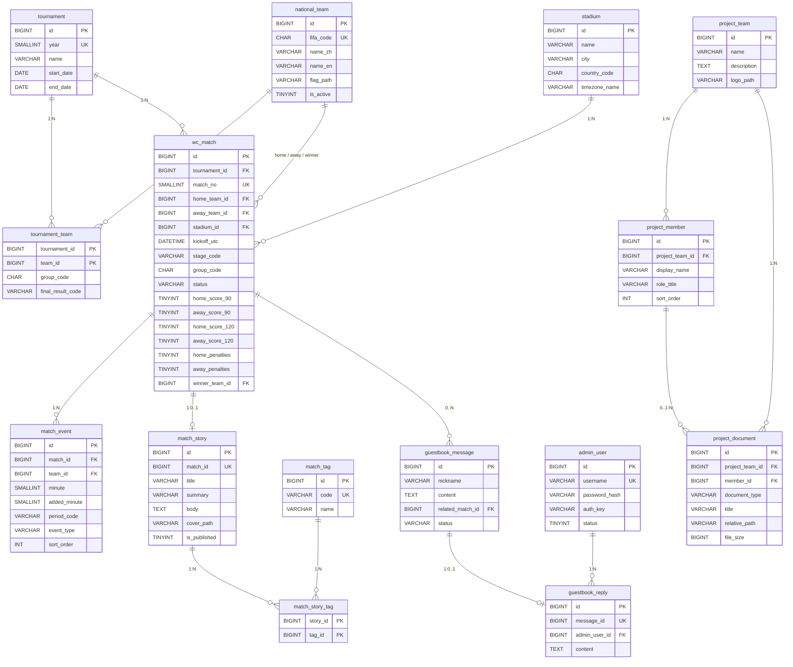

# WorldCup Journey ER 图（15 表冻结草案）

| 项目 | 内容 |
|---|---|
| 文档状态 | 冻结草案；B 七表按 B 拟回复（待 B 负责人审核），A/D 六表待各自确认，C 两表 C 决定 |
| 负责人 | C |
| 依据 | `docs/data-dictionary.md`；V1.1 §3.4 |
| 对应 DDL | `data/install.sql` |
| 说明 | 图中 `PK`/`FK`/`UK` 分别为主键/外键/唯一键；完整字段、NULL/默认值/CHECK 以数据字典和 DDL 为准 |

---

## 1. ER 图

---

## 2. 关系与基数说明

| 关系 | 基数 | 可空性 | 说明 |
|---|---|---|---|
| `tournament` → `tournament_team` | 1:N | 子表 NN | 一届赛事多条参赛关系 |
| `national_team` → `tournament_team` | 1:N | 子表 NN | 球队可参加多届；每届一条 |
| `tournament` → `wc_match` | 1:N | 子表 NN | 每场比赛必属一届赛事 |
| `stadium` → `wc_match` | 1:N | 子表 NN | 每场必有一个场馆 |
| `national_team` → `wc_match` | 1:N（三种角色） | `home/away` NN；`winner` NULL | 主队、客队、胜方是三个不同外键，不能混用 |
| `wc_match` → `match_event` | 1:N | 子表 `match_id` NN；`team_id` NULL | 事件只用于时间轴，不作比分统计 |
| `wc_match` → `match_story` | 1:0..1 | 子表 `match_id` NN + UQ | 一场最多一篇故事 |
| `match_story` → `match_story_tag` | 1:N | 子表两列 NN | 故事标签多对多 |
| `match_tag` → `match_story_tag` | 1:N | 子表两列 NN | 标签可被多篇故事使用 |
| `project_team` → `project_member` | 1:N | 子表 NN | 团队有多名成员 |
| `project_team` → `project_document` | 1:N | 子表 NN | 团队/个人作业文件 |
| `project_member` → `project_document` | 0..1:N | `member_id` NULL | `PERSONAL` 必须绑定成员；`TEAM` 为空 |
| `wc_match` → `guestbook_message` | 0..N | `related_match_id` NULL | 留言可选关联比赛 |
| `guestbook_message` → `guestbook_reply` | 1:0..1 | 子表 NN + UQ | 首版一条留言最多一条回复 |
| `admin_user` → `guestbook_reply` | 1:N | 子表 NN | 管理员回复记录 |

---

## 3. 主键、唯一键、外键汇总

### 3.1 主键

| 表 | 主键 |
|---|---|
| `tournament` | `id` |
| `national_team` | `id` |
| `tournament_team` | `(tournament_id, team_id)` |
| `stadium` | `id` |
| `wc_match` | `id` |
| `match_event` | `id` |
| `match_story` | `id` |
| `match_tag` | `id` |
| `match_story_tag` | `(story_id, tag_id)` |
| `project_team` | `id` |
| `project_member` | `id` |
| `project_document` | `id` |
| `admin_user` | `id` |
| `guestbook_message` | `id` |
| `guestbook_reply` | `id` |

### 3.2 唯一键

| 表 | 唯一键 |
|---|---|
| `tournament` | `year` |
| `national_team` | `fifa_code` |
| `wc_match` | `(tournament_id, match_no)` |
| `match_story` | `match_id` |
| `match_tag` | `code` |
| `admin_user` | `username` |
| `guestbook_reply` | `message_id` |

### 3.3 外键与删除/更新规则

| 外键 | ON DELETE | ON UPDATE |
|---|---|---|
| `tournament_team.tournament_id` → `tournament.id` | RESTRICT | RESTRICT |
| `tournament_team.team_id` → `national_team.id` | RESTRICT | RESTRICT |
| `wc_match.tournament_id` → `tournament.id` | RESTRICT | RESTRICT |
| `wc_match.stadium_id` → `stadium.id` | RESTRICT | RESTRICT |
| `wc_match.home_team_id` / `away_team_id` → `national_team.id` | RESTRICT | RESTRICT |
| `wc_match.winner_team_id` → `national_team.id` | RESTRICT | RESTRICT |
| `match_event.match_id` → `wc_match.id` | RESTRICT | RESTRICT |
| `match_event.team_id` → `national_team.id` | RESTRICT | RESTRICT |
| `match_story.match_id` → `wc_match.id` | RESTRICT | RESTRICT |
| `match_story_tag.story_id` → `match_story.id` | CASCADE | RESTRICT |
| `match_story_tag.tag_id` → `match_tag.id` | RESTRICT | RESTRICT |
| `project_member.project_team_id` → `project_team.id` | RESTRICT | RESTRICT |
| `project_document.project_team_id` → `project_team.id` | RESTRICT | RESTRICT |
| `project_document.member_id` → `project_member.id` | RESTRICT | RESTRICT |
| `guestbook_message.related_match_id` → `wc_match.id` | RESTRICT | RESTRICT |
| `guestbook_reply.message_id` → `guestbook_message.id` | RESTRICT | RESTRICT |
| `guestbook_reply.admin_user_id` → `admin_user.id` | RESTRICT | RESTRICT |

**原则：** 不因删除赛事/球队/场馆而级联清空比赛历史；可空外键不等于 `SET NULL`；仅 `match_story_tag.story_id` 允许清理关联。

---

## 4. 关键约束说明

### 4.1 `wc_match`

- `match_no` 与 `tournament_id` 联合唯一，范围 1—104。
- `home_team_id <> away_team_id`。
- `stage_code`、`status` 使用固定枚举。
- `group_code`：仅 `GROUP` 可填 A—L；`GROUP` 允许 `NULL`；非 `GROUP` 必须 `NULL`。
- 90/120/点球比分分别成对；`FINISHED` 必须有 90 分钟比分。
- 120 分钟为累计比分，每侧不小于对应 90 分钟比分。
- 点球必须分出胜负，不能加入场上比分；点球胜方与 `winner_team_id` 一致。
- `winner_team_id` 非空必须为本场双方之一；小组赛不填；已结束淘汰赛/季军赛/决赛必须有值。
- `SCHEDULED`、`POSTPONED`、`CANCELLED` 不得填写赛果。
- 跨表规则（双方属于该赛事、事件球队属于本场双方）由导入/Model/Service 保证，不能只靠普通 FK。

### 4.2 `match_event`

- `period_code`：`H1/H2/ET1/ET2/SHOOTOUT`。
- `event_type`：`GOAL/OWN_GOAL/YELLOW/RED/PENALTY_GOAL/PENALTY_MISS/OTHER`。
- 非 `SHOOTOUT` 的 `minute` 必填；无补时 `added_minute` 为 `NULL`。
- 事件排序 `sort_order ASC, id ASC`；统计不读事件条数。

### 4.3 `tournament_team`

- 联合主键 `(tournament_id, team_id)`。
- `group_code` A—L，参赛关系必填。
- `final_result_code` 可为 `NULL`；只表示最终成绩类别，不是官方排名。

### 4.4 `project_document`

- `document_type='PERSONAL'` 必须绑定 `member_id`；`TEAM` 不绑定成员。
- 文件只能来自受控的 `data/team` 或 `data/personal`，路径不能含 `..`。

### 4.5 `guestbook_reply`

- `message_id` 唯一：一条留言最多一条管理员回复。
- 回复在留言审核通过后才公开显示。

---

## 5. 审计字段与空值

- 审计字段逐表方案见 `docs/data-dictionary.md` §2；不是 15 表统一。
- `match_tag`、`match_story_tag` 不加审计字段。
- 可空字段用 `NULL` 表示缺失；真实 `0` 保留，不把缺失比分补成 0。
- 时间按 UTC 存储；页面转换为 `Asia/Shanghai` 并标注北京时间。

---

## 6. 待确认

1. B 负责人对 B 拟回复（`e0d9e21`）的最终审核。
2. A 三张表的审计字段/`file_size` 是否可空。
3. D 三张表的字段与默认值。
4. `final_result_code` 的可靠值。
5. MySQL 8.0.12 对 CHECK 只解析不强制执行；需 8.0.16+ 才真正生效。

**说明：** 本图是冻结草案，不是四方已签字版本；与 `docs/data-dictionary.md`、`data/install.sql` 必须保持一致。
