# WorldCup Journey 实现文档

课程：互联网数据库开发

团队：WorldCup Journey 开发小组

成员：卢苑（2413275）、胡乐妍（2413272）、袁颢心（2411539）、张馨月（2414029）

代码基线：main `e5f8222`，2026 年 11 月 26 日。

## 1 实现范围

项目以 2026 世界杯为主题，将球队资料、比赛查询、球队旅程、统计图表和观赛记录连接起来。访客无需注册即可使用前台；管理员登录后维护赛事内容、课程资料并审核留言。

本文按实际代码说明实现。页面使用方法另见 [用户手册](../user-manual/用户手册.md)，环境安装和数据库恢复见同目录中的部署文档。本文中的代码路径均相对项目根目录。

| 部分 | 实现内容 | 主要负责人 |
| --- | --- | --- |
| 公共页面与课程资料 | 首页、导航、团队成员、文件上传下载、纪念卡 | A 卢苑 |
| 赛事内容 | 比赛查询及维护、故事与事件、导入工具、地图和图表、启动流程 | B 胡乐妍 |
| 球队与数据库 | 数据库结构、球队与参赛关系、列表和统计服务 | C 袁颢心 |
| 登录与互动 | 管理员认证、访问控制、留言审核回复、系统集成 | D 张馨月 |

球队图文完善由四人分别负责 12 队，最终通过统一服务、模板和素材署名表接入。各成员贡献文件保存在 `docs/team-profile-contributions/`，不会由应用自动扫描加载。

## 2 应用结构与请求处理

当前代码采用 Yii2 Advanced 多应用结构。前台、后台和控制台共用模型、服务及数据库配置，独立配置控制器命名空间与默认路由。

```text
frontend/       公开页面的控制器、视图、配置和入口
backend/        管理后台的控制器、视图、配置和入口
console/        初始化、部署、导入等命令
common/         共用配置、引导及跨应用 URL 管理
models/         ActiveRecord 模型和表单校验
services/       查询、统计、资料存储和数据导入
views/layouts/  共用前台、后台及登录布局
web/            本机兼容入口与共用静态文件
data/           建表脚本、导入数据及课程附件
```

### 2.1 前后台分发

课程本机部署使用 `web/index.php`。入口先加载共用引导，再通过 `ApplicationUrlManager::isBackendRoute()` 判断路由：`auth` 和 `admin-` 开头的控制器进入后台应用，其余进入前台应用。这样保留原先 `index.php?r=...` 的链接，同时完成应用结构迁移。

例如访问 `index.php?r=national-team/view&id=37` 时，执行前台 `NationalTeamController`；访问 `index.php?r=admin-team/view&id=37` 时，执行后台 `AdminTeamController`。实际 ID 取决于数据库，不应写死为业务标识。

独立部署时可分别以 `frontend/web/`、`backend/web/` 为公开目录，并用 `WCJ_FRONTEND_ENTRY`、`WCJ_BACKEND_ENTRY`、`WCJ_ASSET_URL` 生成跨应用链接和共用静态资源地址。PHP 内置服务器的单地址方式用于本机演示。

### 2.2 控制器 服务和视图的分工

以球队对比为例：控制器接收 `left_id`、`right_id`，检查参数后调用 `TeamStatsService`；服务查询本届完赛比赛并计算指标；视图输出表格及图表需要的数据；浏览器中的 ECharts 将数据绘成双环图。控制器和视图不再各写一套统计 SQL。

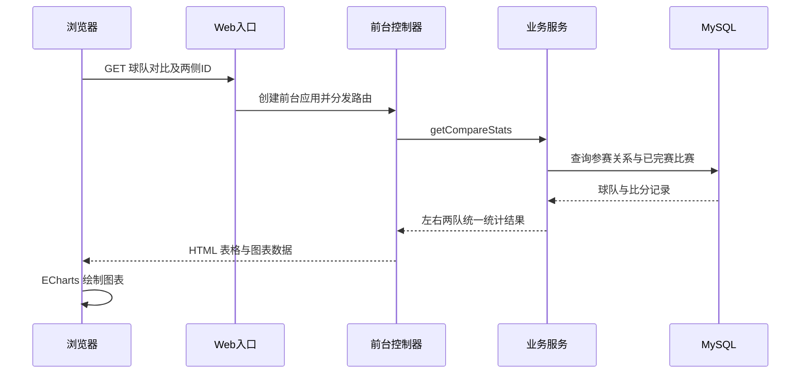

## 3 数据库实现

数据库结构以 `data/install.sql` 为准，使用 MySQL、InnoDB 和 utf8mb4，共 15 张业务表。数据库设计文档解释建模过程，运行时则由 ActiveRecord 和服务层读写这些表。

| 数据组 | 表 | 作用 |
| --- | --- | --- |
| 球队及参赛 | national_team、tournament_team | 分离球队身份和具体届次的小组、成绩、档案 |
| 赛事及赛程 | tournament、stadium、wc_match | 保存届次、场馆、对阵、时间、阶段和比分 |
| 内容及事件 | match_story、match_event、match_tag、match_story_tag | 比赛故事、时间轴及多对多标签 |
| 课程资料 | project_team、project_member、project_document | 团队、成员和文件元数据 |
| 管理与互动 | admin_user、guestbook_message、guestbook_reply | 登录身份、待审核内容及管理员回复 |

### 3.1 关系与约束

`tournament_team` 将球队与届次关联，用联合主键避免同一届重复登记。`wc_match` 分别关联主队、客队、场馆和赛事。`match_story.match_id` 的唯一约束限制一场比赛最多一篇故事，`match_story_tag` 用联合主键避免重复挂载标签。

`project_member` 归属于团队，个人文件关联成员。`guestbook_reply.message_id` 唯一，保证一条留言最多一条管理员回复。外键与删除限制用于保护已有比赛、课程资料及互动记录；不是通过删除一条球队记录来清空它的全部历史。

本届球队档案增量保存在 `tournament_team.profile_json`。球队名称等基础身份仍由球队表维护，教练和代表球员则随届次保存，避免跨届资料互相覆盖。

### 3.2 时间与空值

比赛时间按 UTC 存储，前台赛程、旅程和日历转换为北京时间。后台比赛表单明确要求输入 UTC，后台留言时间也标注 UTC。没有发生的加时或点球使用空值，与真实的 0 比分区别处理。

## 4 球队查询和档案

### 4.1 搜索与详情

`frontend/controllers/NationalTeamController.php` 处理列表、详情和比较。列表支持中文名、英文名和 FIFA 代码，并使用分页限制一次返回的记录。详情结合参赛关系展示本届成绩，不把所有历史球队都直接当作本届参赛队。

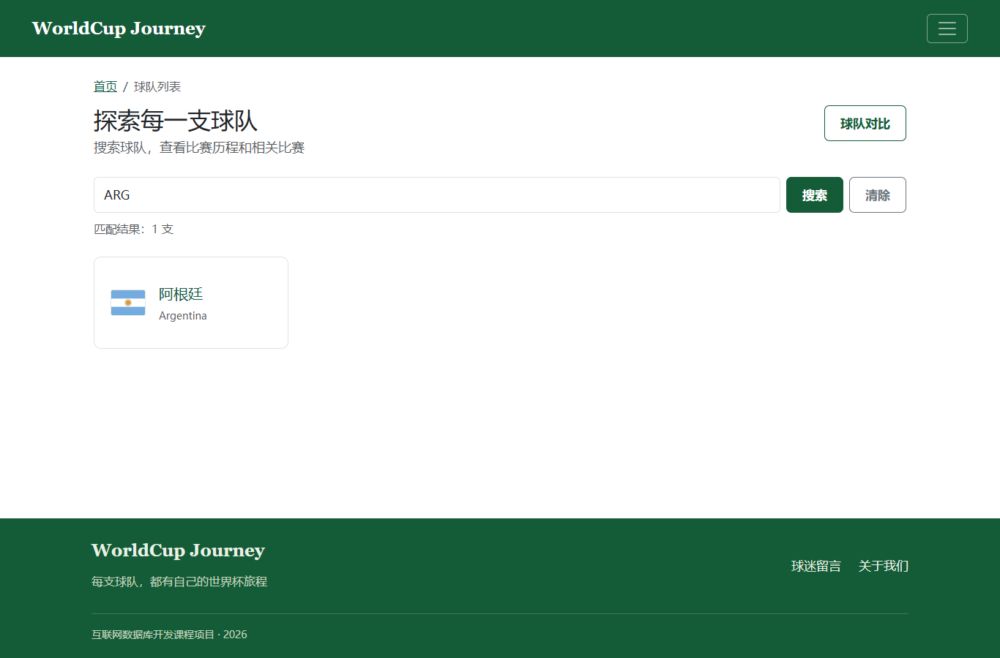

### 4.2 固定名单和人物照片

基础名单快照在 `data/team-profiles-2026.json`，增强数据在 `data/team-profile-features-2026.json`，图片署名在 `web/images/team-profiles/credits.json`。`TeamProfileService` 负责基础档案，`TeamProfileFeatureService` 校验增强名单及照片映射。

增强名单保留球衣号码、位置、原文姓名、原文俱乐部、累计出场和进球，并增加中文显示。服务先检查来源 URL、资料版本及 26 人结构，再按号码、姓名、位置匹配代表球员。照片还要核对署名记录中的人物姓名和实际文件，避免改过身份后仍显示原人物照片。

所有球队复用 `_profile_feature.php`、`_profile_photo.php` 和 `team-profile.css`。名单按位置分组，使用原生 details 元素折叠；来源区显示资料版本和逐图署名。显示裁切参数用于适配不同照片，不为每支球队另建页面。

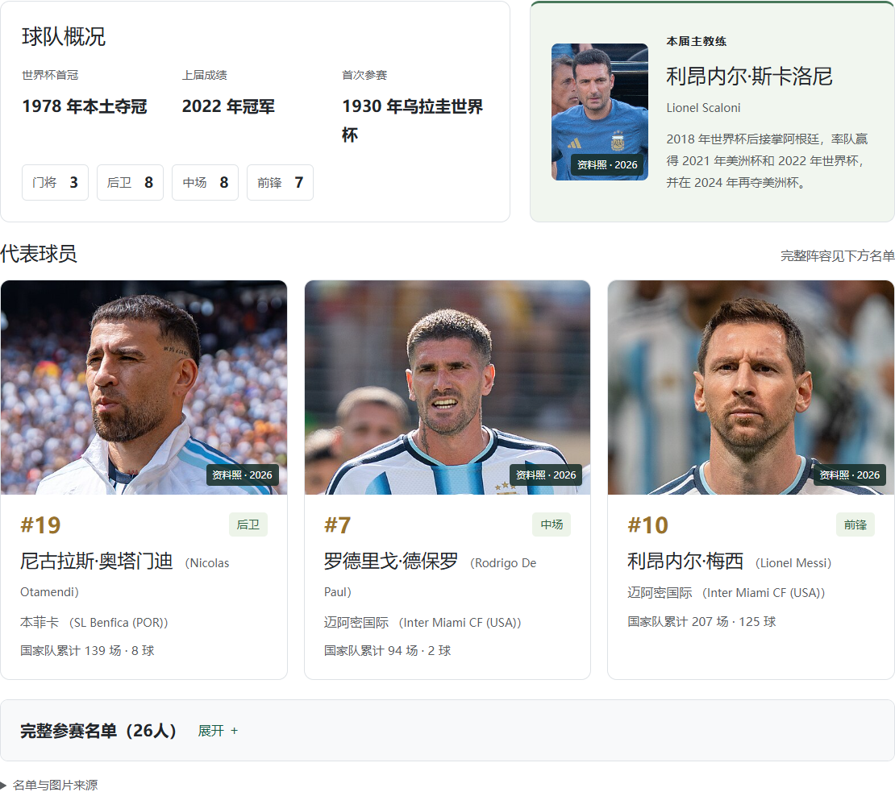

国家队累计数据属于固定名单版本，本届统计来自比赛表，两者在页面上分别说明。历史照片按年份标注，不依据照片球衣推断名单中的俱乐部。

## 5 比赛查询与故事

`MatchQueryService` 为比赛列表和详情组织数据。列表接受阶段、球队、精选状态等条件，返回比赛记录及分页信息；比赛视图负责展示主客队、状态、时间和不同阶段比分。非法参数、未知记录和资料缺失分别处理，不能用 0∶0 代替缺失赛果。

公开故事以发布状态为条件。管理员在后台维护标题、摘要、纯文本正文、封面相对路径和来源 URL，通过确认事实与素材许可后发布。页面使用编码后的文本输出，正文换行保留，但 HTML 不作为代码执行。

比赛事件与故事一起组织为时间轴，包含时段、基础分钟、补时、类型、球队及球员信息。分钟和补时分开存储，例如 45+2 表示基础分钟 45、补时 2。事件关联球队必须属于本场对阵双方。

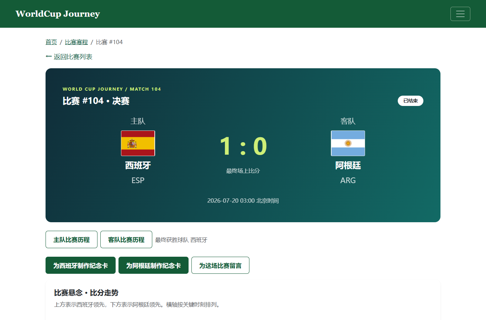

`MatchMomentumService` 根据事件组织比分走势。只有具备足够事件依据时才能展示对应走势；缺少完整事件的比赛保留基本赛果，不生成虚构的进球时间。

## 6 统一统计和数据可视化

`TeamStatsService` 是球队详情、对比和进球排名的统一统计入口，统计 2026 届 `FINISHED` 比赛。先读取球队参赛资格，再为每场比赛分别累计主客队指标。

场上最终比分优先使用 120 分钟累计值，否则使用 90 分钟值。120 分钟不与 90 分钟再次相加，点球大战命中数不计入进球。场上平局与点球大战获胜分别记录，所以胜平负和点球获胜可以同时正确表达。

场均进球、场均失球和胜率以已完赛场次为分母。没有完赛记录时返回空值，视图显示“暂无”，避免除零和误导性的零值。两队比较保持输入左右顺序，不允许用同一球队代替双队比较。

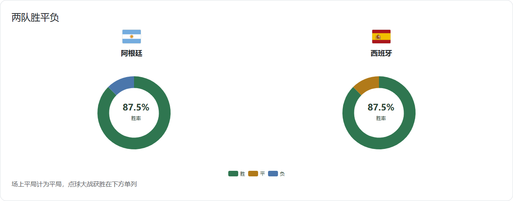

| 展示 | 服务或实现位置 | 数据处理 |
| --- | --- | --- |
| 晋级流向 | JourneyFlowService | 按赛事阶段组织球队流向，提供追踪球队数据 |
| 进球排名与攻防坐标 | TeamStatsService、insight 页面及脚本 | 统一聚合后绘制柱状图和散点图 |
| 比赛日历 | MatchQueryService、match-calendar.js | 按北京时间归日，点击日期定位比赛 |
| 球队旅程 | JourneyService | 按开赛时间组织比赛与晋级记录 |
| 场馆地图 | JourneyMapService、旅程地图脚本 | 关联场馆位置与球队比赛，联动地图点位和记录 |

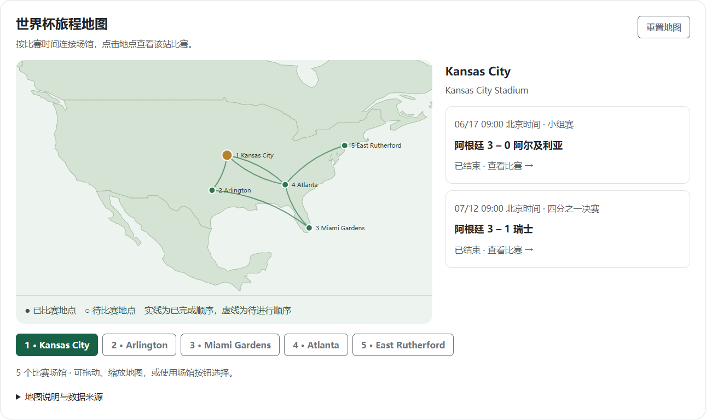

图表使用 Apache ECharts。图表只承担展示与交互，核心比分和统计规则在服务层维护。页面提供数据表、加载状态或暂无数据提示，使无数据和加载失败能够区分。

## 7 浏览器纪念卡

`MemoryCardService` 提供选定球队与比赛的展示数据，`frontend/views/memory/card.php` 输出编辑区和预览，`web/js/memory-card.js` 在 Canvas 上绘制最终卡片。

选择球队或比赛会触发异步请求，更新比赛选项和预览数据，并保留当前感想、照片。脚本使用请求取消和版本检查处理快速切换，避免较早的响应覆盖较新的选择。预览准备完成前禁用下载。

感想最多 100 字，可选照片支持 JPG、PNG、WebP，大小不超过 5 MB。照片由浏览器读取，Canvas 合成比赛信息、国旗、感想和照片后导出 PNG。个人感想和照片不作为上传内容写入数据库，因此也没有个人草稿箱。

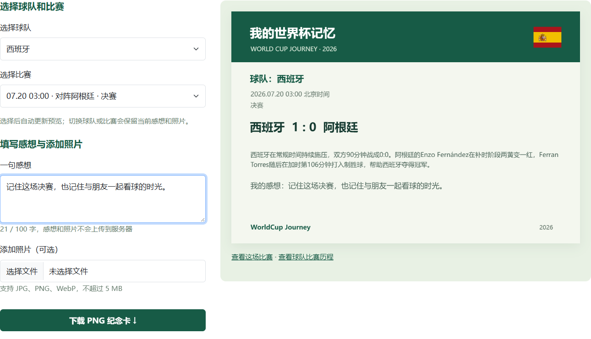

## 8 管理员认证和访问控制

### 8.1 登录流程

后台 `AuthController` 接收 `AdminLoginForm`。模型校验输入后，按用户名和启用状态查找 `AdminUser`，使用 Yii 的密码验证方法比对 `password_hash`，成功后建立用户会话并更新登录时间。数据库保存密码哈希，不保存供登录验证使用的明文密码。

后台共用配置把身份类设为 `AdminUser`，关闭自动登录，指定管理员会话身份参数。登录页仅用于维护人员，普通浏览和留言不需要管理员账号。错误账号或密码统一返回校验错误，不返回密码哈希。

### 8.2 写操作保护

后台控制器通过 AccessControl 或管理员检查器限制访问。退出、审核和回复等改变状态的操作限制为 POST，表单保留 Yii CSRF 校验。页面编码昵称、留言和其他用户输入，避免把输入内容解释成脚本。

“界面中不显示按钮”不等于权限控制，检查在请求处理端执行。未经登录直接访问维护路由时，应先进入登录流程；登录不能绕过表单、业务和数据库约束。

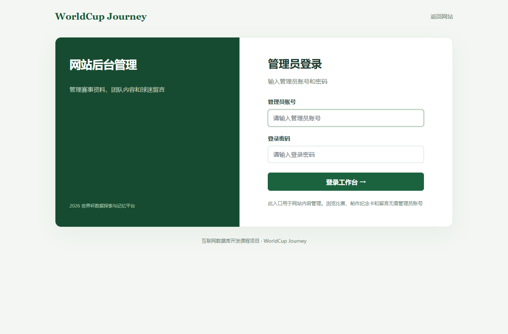

## 9 留言审核与回复

### 9.1 访客提交

`GuestbookController::actionCreate()` 只接收昵称、正文、关联比赛三个字段，状态在服务端固定初始化为 `PENDING`。昵称最多 50 字，正文最多 2000 字；关联比赛为可选项，非空时检查比赛是否存在。

保存成功后设置提示并使用 303 重定向回列表，避免刷新结果页重复提交。表单不通过时返回带校验信息的页面。公开列表只查询 `APPROVED` 留言，并预加载对应回复。

### 9.2 状态与回复事务

后台 `AdminGuestbookController` 处理审核和回复。审核仅接受 `APPROVED`、`REJECTED` 两种目标状态，公开列表随状态变化更新。

回复必须针对已通过的留言。控制器在数据库事务中对留言行执行 `SELECT ... FOR UPDATE`，重新检查状态，再检查是否已有回复，最后写入管理员身份和回复内容。行锁与 `message_id` 唯一约束共同防止并发重复回复。

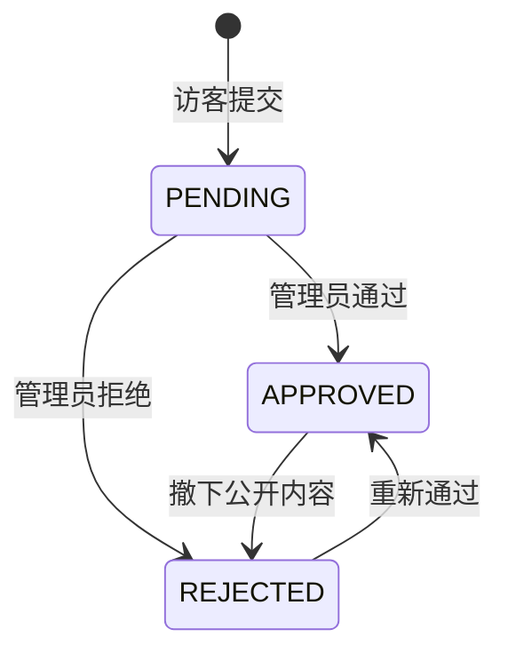

回复是留言的关联记录，不是第四种审核状态。一条留言最多一条管理员回复；待审核、拒绝状态不能新增回复。并发状态变化或重复回复返回冲突，不静默覆盖原回复。

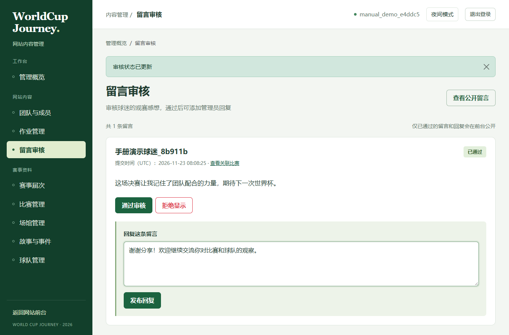

## 10 团队和作业文件

团队、成员、文件分别对应 `ProjectTeam`、`ProjectMember`、`ProjectDocument`。个人作业必须关联同一团队内的成员，团队作业不绑定个人成员。前台“关于我们”从实际登记记录生成成员卡片与下载入口。

文件本体保存在 Web 根目录之外的 `data/team/` 和 `data/personal/`，数据库保存标题、原文件名、大小、类型和相对路径。`DocumentStorageService` 生成随机文件名，避免直接把原始名称作为服务器路径。

下载由控制器根据文件记录处理。服务检查目录类型、文件名格式、扩展名，并使用 realpath 核对文件仍在允许的根目录内，防止通过构造相对路径访问其他文件。

上传通过模型验证扩展名、MIME 和 20 MB 限制。编辑时不选择新文件保留旧文件，选择新文件则走替换流程；不能只改页面文案却遗漏文件元数据。已有作业的成员不能随意删除，避免附件失去归属。

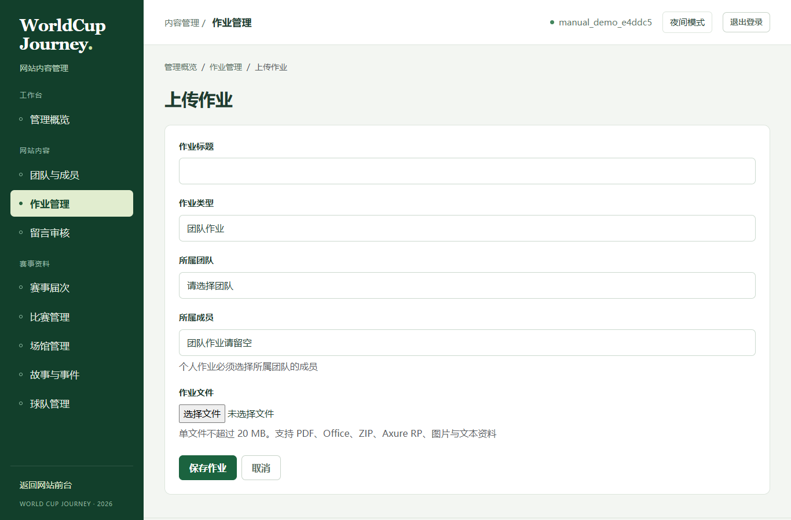

清单文件 `data/a-documents-manifest.json` 至 `data/d-documents-manifest.json` 用于部署时登记资料，包含大小及 SHA-256。Git 同步只取得文件，不会自动向一个已经运行的旧数据库插入全部登记记录。已有环境需执行相应登记命令，不能把页面缺记录误判为分支没有文件。

## 11 数据准备和部署实现

Windows 入口为 `scripts/start.ps1`，控制台部署命令在 `console/controllers/DeployController.php`。脚本校验 PHP、Composer 和端口，准备本机配置，安装锁定依赖，再执行数据库准备、赛事导入、档案准备和团队资料登记。

`DatabaseSetupService` 处理建表准备，`MatchDataImportService` 处理赛事导入。项目导入资料覆盖 48 队、16 场馆、104 场比赛和 8 篇故事及事件标签。导入的数据范围与当前管理员的发布状态分别管理，重复部署不应直接抹掉人工维护结果。

导入过程进行结构、关联和数据冲突检查，业务写入使用事务。目标库是陌生的部分结构或已有非空冲突时，应报告问题，不能通过清空整个数据库“修复”。数据库 DDL 的提交行为与业务事务不同，因此准备流程另有建表检查点和恢复处理。

数据库连接和 Cookie 密钥通过本地配置提供，配置文件在 Git 忽略范围内。首次初始化仅在管理员表为空时创建管理员并显示随机密码，不能把某台电脑的密码写成项目通用口令。

## 12 项目协作

团队使用 Trello 管理项目任务，使用 GitHub 保存源码、提交记录和分支合并。Trello 对应任务层面的安排与跟进；Git 提交、PR、逐队来源和验收记录用于核对具体交付内容。

项目看板：[WorldCup Journey](https://trello.com/b/6b062fd504becb027a802852/worldcup-journey)。本文不公开带加入令牌的邀请链接。

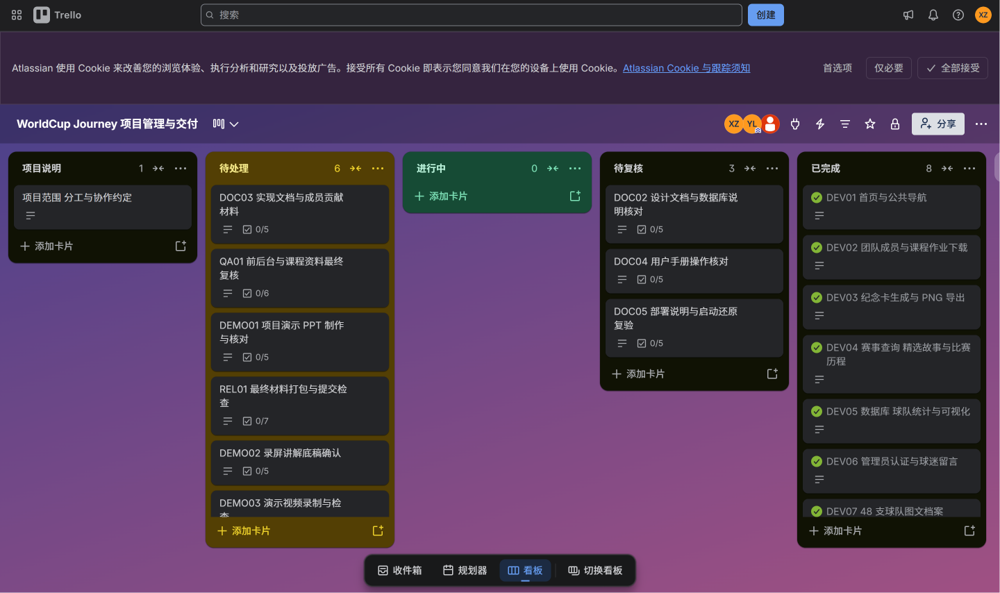

图中为团队使用的 Trello 项目看板，按“项目说明”“待处理”“进行中”“待复核”“已完成”组织任务。任务卡片采用 DEV、DOC、QA、DEMO、REL 等编号，分别对应功能开发、文档、质量检查、演示和交付工作，用于跟踪任务流转及复核安排。截图记录看板在拍摄时的状态。

成员开发内容在分支上提交，再合入 main 联调。共享模型、统计口径、照片署名和运行 JSON 需要协调合并，不能直接整文件覆盖另一成员的更新。球队资料按代码保留贡献片段、来源、验收记录和截图，便于按队检查身份与素材。

分支“已有文件”和运行数据库“已登记记录”是两件事。例如个人作业文件合入 main 后，旧数据库仍需按成员归属登记，前台才能展示。联调时同时检查源码、附件与数据库状态。

## 13 实现验证

验证分成结构检查、数据库与 HTTP 联调、浏览器交互三层。测试脚本位于 `tests/integration/`，每份脚本覆盖自己的业务规则；不能仅凭首页返回 200 宣称全部功能通过。

| 验证对象 | 检查方式 | 主要检查点 |
| --- | --- | --- |
| 球队图文 | team-profile-feature.php | 名单人数、身份与版本匹配、图片哈希及实际 HTTP 页面 |
| 赛事模块 | b-module.php | 查询、后台维护及关联规则，按脚本使用隔离环境 |
| 数据导入 | match-data-import.php | 重复导入、数据关系和冲突处理 |
| 部署 | deployment.php | 新环境准备、初始化与重复执行 |
| 团队资料 | project-module.php | 成员归属、文件上传下载及删除约束 |
| 浏览器交互 | 实际页面操作及浏览器检查脚本 | 图表、选择联动、PNG 导出、留言审核公开 |

用户手册制作过程中，已实际执行纪念卡 PNG 导出、个人作业下载，以及演示留言的提交、审核、回复和前台公开，核对了浏览器导出、文件下载和前后台互动流程。验证结束后清理了临时账号与演示留言。

本文配图取自本项目实际页面，覆盖球队搜索与档案、球队对比、旅程地图、比赛详情、纪念卡、管理员登录、留言审核回复和作业上传。截图用于说明模块界面及操作结果；其中的本机 ID、数量和账号名不作为部署参数。

## 14 代码定位

以下为本文对应的实际源码位置，便于从说明追到实现：

- [web/index.php](../../web/index.php)
- [common/components/ApplicationUrlManager.php](../../common/components/ApplicationUrlManager.php)
- [common/config/web.php](../../common/config/web.php)
- [data/install.sql](../../data/install.sql)
- [frontend/controllers/NationalTeamController.php](../../frontend/controllers/NationalTeamController.php)
- [services/TeamStatsService.php](../../services/TeamStatsService.php)
- [services/TeamProfileFeatureService.php](../../services/TeamProfileFeatureService.php)
- [services/MatchQueryService.php](../../services/MatchQueryService.php)
- [services/MemoryCardService.php](../../services/MemoryCardService.php)
- [web/js/memory-card.js](../../web/js/memory-card.js)
- [models/AdminLoginForm.php](../../models/AdminLoginForm.php)
- [backend/controllers/AuthController.php](../../backend/controllers/AuthController.php)
- [frontend/controllers/GuestbookController.php](../../frontend/controllers/GuestbookController.php)
- [backend/controllers/AdminGuestbookController.php](../../backend/controllers/AdminGuestbookController.php)
- [services/DocumentStorageService.php](../../services/DocumentStorageService.php)
- [services/MatchDataImportService.php](../../services/MatchDataImportService.php)
- [console/controllers/DeployController.php](../../console/controllers/DeployController.php)
