# WorldCup Journey 用户手册

本手册介绍网站前台的使用方法，以及管理员日常维护资料的操作。普通访客无需注册，可以直接查询比赛、制作纪念卡、留言和下载作业。

## 打开网站

在项目根目录打开 PowerShell，运行：

```powershell
.\scripts\start.ps1
```

等终端出现 `Ready at` 后，打开后面的地址。通常是 `http://127.0.0.1:8080/`，端口以终端显示为准。使用期间不要关闭启动终端。首次安装和数据库配置见仓库中的部署文档。

导航折叠时，点击右上角菜单按钮。导航中的“夜间模式”和“日间模式”可以切换页面颜色。

## 搜索并打开球队

1. 点击顶部“球队”，进入“探索每一支球队”页面。
2. 在“中文名 / 英文名 / FIFA 代码”输入框输入关键词，例如“阿根廷”、Argentina 或 ARG，点击“搜索”。
3. 查看下方匹配数量，点击球队卡片进入详情。列表较长时，通过底部页码或“上一页”“下一页”切换。
4. 需要重新浏览全部球队时，点击搜索框旁的“清除”。需要比较两队时，点击列表右上角的“球队对比”。

没有匹配结果时，先检查拼写或改用三位 FIFA 代码。球队名称卡片是详情入口，国旗用于识别球队。

页面只展示当前版本允许公开的参赛球队，实际可见数量以数据库和页面提示为准。

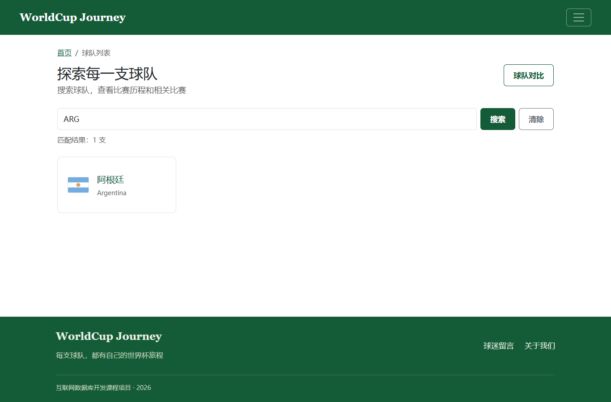

## 阅读球队档案

1. 在球队列表打开阿根廷等球队，先查看名称、FIFA 代码和球队概况。
2. 阅读教练姓名与经历，再查看三位代表球员的号码、位置、俱乐部和国家队累计数据。照片角标标明资料照年份。
3. 继续向下查看“本届赛事表现”，了解已完赛、胜平负、进失球及最终成绩。
4. 使用页面中的球队旅程或比较入口，进一步查看比赛历程，或预选当前球队后与其他球队比较。

球员国家队累计出场和进球采用档案注明的固定 FIFA 名单版本，不能当作本届世界杯统计。

代表球员是项目按既定规则选取的展示样本，不代表首发阵容或官方最佳阵容。历史照片中的球衣与当前档案俱乐部可能不同。

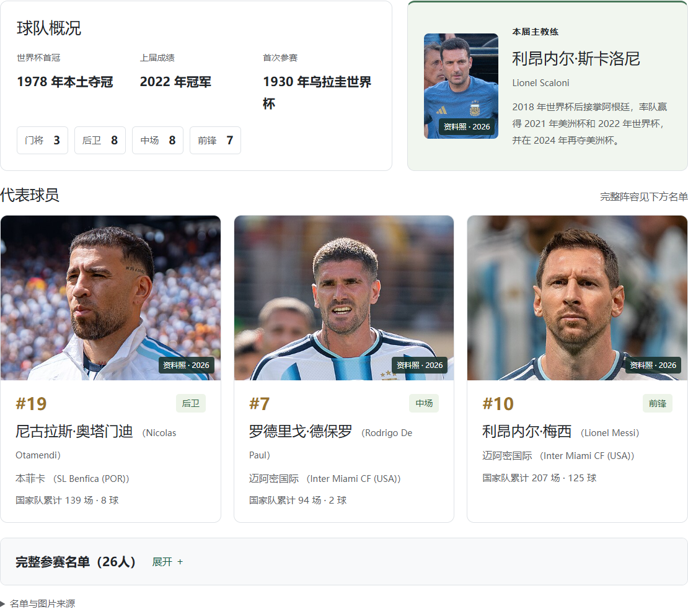

## 展开完整名单和查看来源

1. 进入提供完整名单的球队详情，找到“完整参赛名单（26人）”。
2. 点击标题或“展开 ＋”，查看各位置分组、球衣号码、球员和俱乐部。也可用 Tab 聚焦标题，再按 Enter 展开。
3. 需要收起时，再次点击标题或“收起 −”。页面中的位置人数可与完整名单各分组对应查看。
4. 点击“名单与图片来源”，打开固定名单版本、球队历史、中文译名参考及逐图来源和许可链接。

部分球队仅提供基础档案。只有实际显示“完整参赛名单”的页面适用本节；未显示该入口时，仍可阅读已有档案与赛事统计。

照片年份和许可各自对应具体图片。中文姓名属于辅助显示，核对人物时请同时参考原文、号码和固定版本。

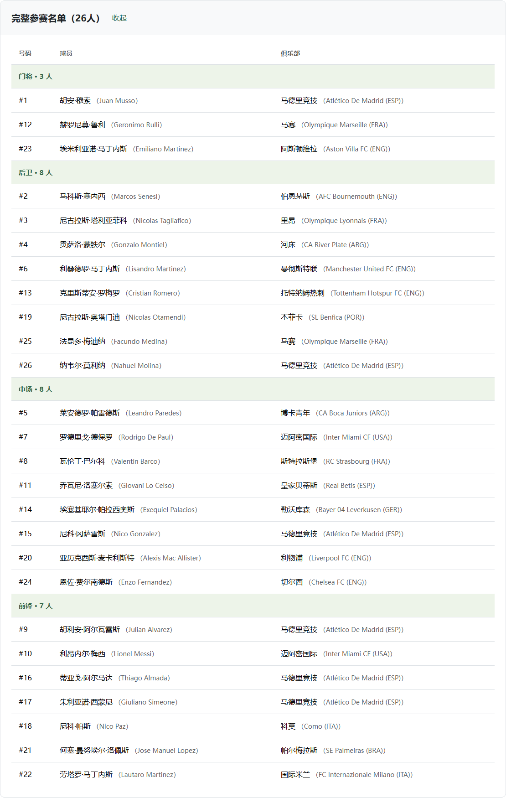

## 比较两支球队

1. 从球队列表右上角点击“球队对比”；也可从球队详情的比较入口进入，此时可预选当前球队。
2. 分别在左右两侧选择要比较的球队，点击“比较球队”加载结果。
3. 先阅读双环胜平负图和胜率，再查看下方完整统计表中的已完赛、进球、失球、场均数据及最终成绩。
4. 点击“交换球队”调换左右球队；要重新比较，修改两侧选择并再次点击“比较球队”。

图表需要 JavaScript。没有完赛记录时，场均值或胜率可能显示暂无，不能把缺失记录解释为零水平。

点球大战单列；统计表中的进球不把点球大战罚进数量加到场上进球。具体字段以页面说明为准。

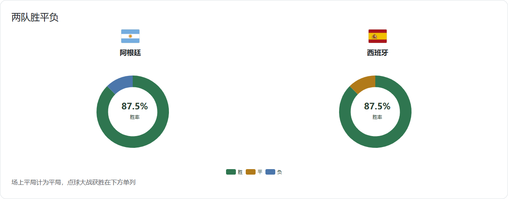

## 沿球队旅程查看比赛

1. 从球队详情打开球队比赛历程，或从数据图表的球队信息卡点击“查看比赛历程”。
2. 在“查看球队历程”区域选择球队，点击“查看历程”，切换查看对象。
3. 沿“赛程与晋级历程”向下阅读，核对对手、阶段、北京时间、比分和晋级标识。点击“比赛详情 →”打开单场页面。
4. 有精选故事的比赛可点击“阅读精选故事”；地图上的比赛点位可与列表记录配合查看。“全部比赛”返回赛事列表。

地图和时间线反映数据库已登记的比赛及场馆。暂无记录时，页面会提示暂无赛程，不需要反复提交同一查询。

时间线中的比赛详情可以继续通往纪念卡或留言，适合按“球队—比赛—个人记录”的顺序使用。

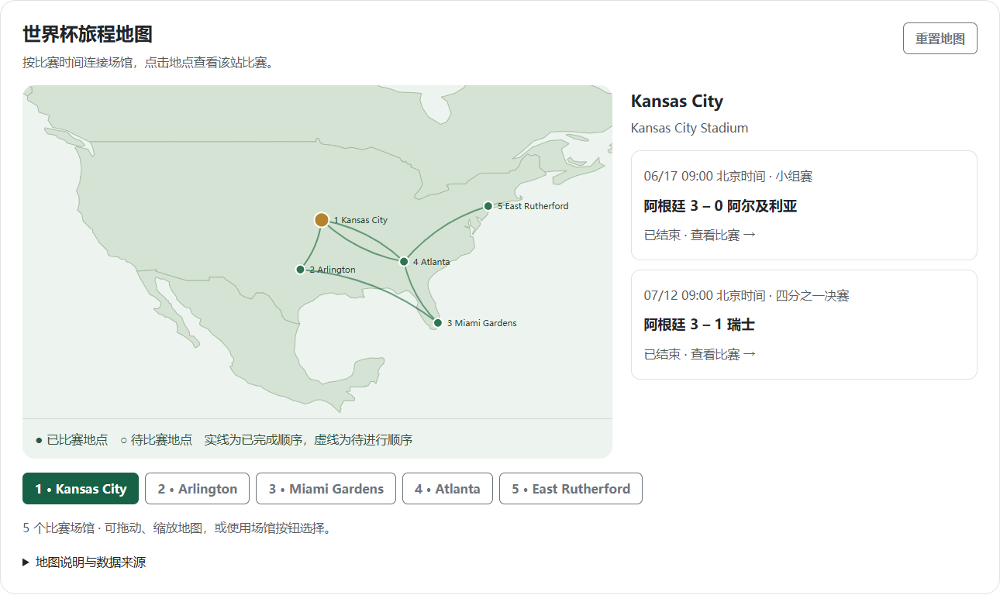

## 筛选赛程和精选比赛

1. 点击顶部“比赛”，在筛选区域选择“比赛阶段”和“球队”。不限制时保留全部选项。
2. 只想阅读已发布故事对应的比赛时，勾选“只看精选”，点击“筛选比赛”。
3. 查看列表上方的比赛数量和当前条件。使用条件标签上的 × 去掉某一条件，或点击“重置”恢复默认列表。
4. 从列表打开比赛详情。结果较多时，使用列表底部的分页按钮继续查看。

某个阶段没有精选比赛时，页面可能提示已切换至全部阶段；查看提示后再确认当前结果。

“未开始”“进行中”“已结束”等状态决定比分的显示方式。比赛不存在有效赛果时，页面不会用虚构比分代替。

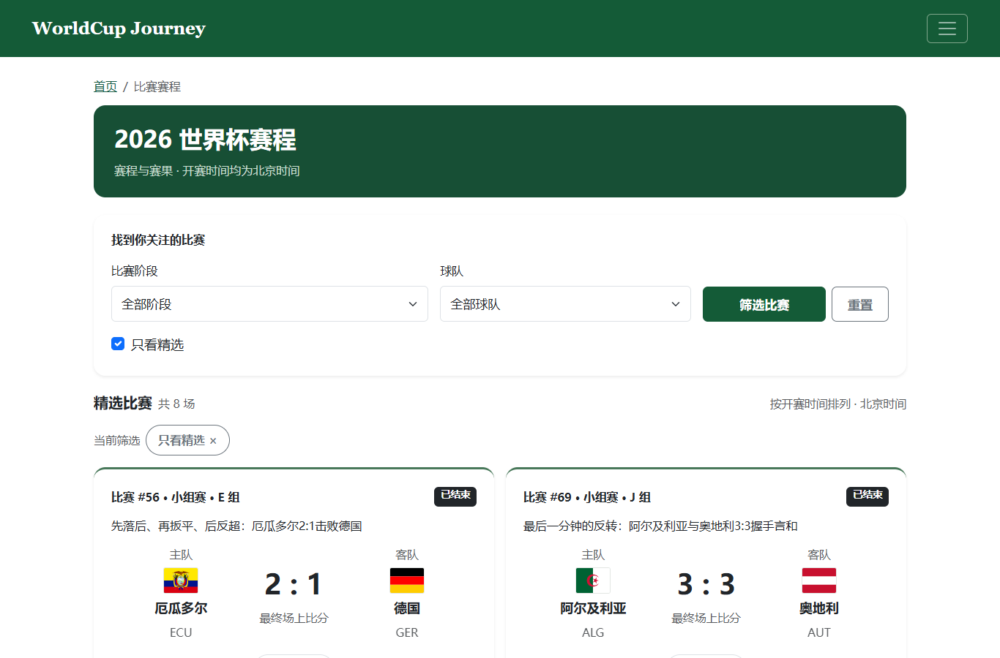

## 阅读比赛详情和精选故事

1. 从比赛列表或球队旅程打开一场比赛，先确认对阵、比赛编号和状态。
2. 分别阅读 90 分钟、120 分钟和点球大战信息。仅进行常规时间的比赛，不需要另找不存在的加时或点球结果。
3. 向下阅读精选故事及事件时间轴。页面提供事件筛选或比分走势时，可选择事件或节点，查看对应时刻。
4. 使用比赛页面中的纪念卡、留言或球队入口，继续制作个人记录、关联留言或回到球队资料。

120 分钟比分是加时结束的累计场上比分。例如 90 分钟 1∶1、120 分钟 2∶1，最终场上比分为 2∶1。

只有已发布故事的比赛展示对应正文和事件；比分走势还取决于事件记录完整度。未显示不一定是页面故障。

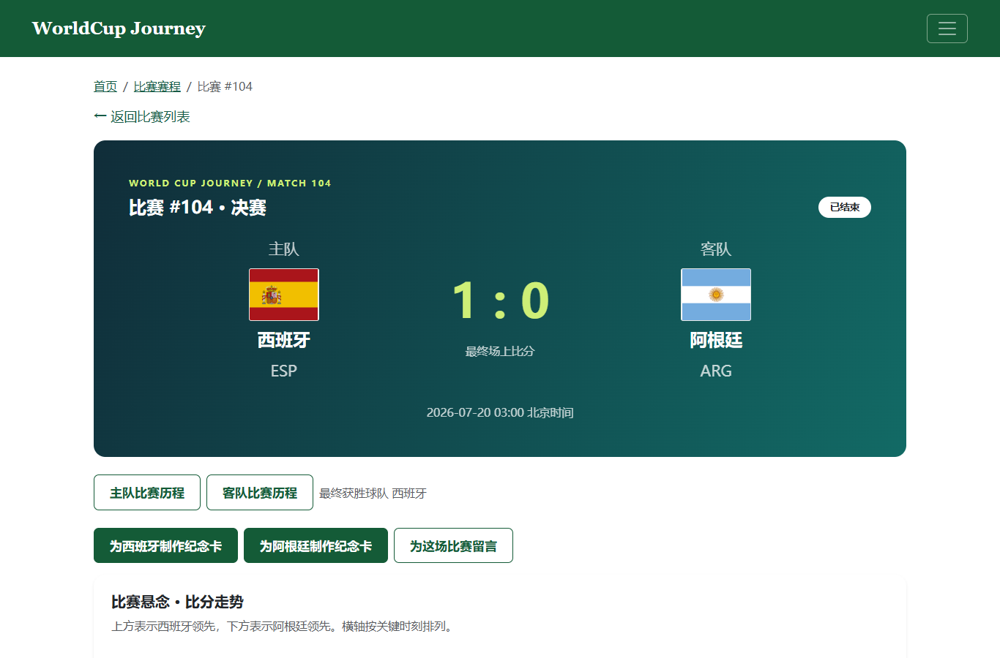

## 使用晋级流向和进球排名

1. 点击顶部“数据总览”。使用页内入口跳转到“晋级流向”“进球排名”“攻防表现”或“比赛日历”。
2. 在“通往冠军的旅程”中查看球队在不同阶段之间的联系，移动指针查看图表提示。窄屏下可在图表区域横向滚动。
3. 向下阅读“球队进球排名”，比较各队进球情况。需要精确数字时，结合页面提供的数据表阅读。
4. 要从统计回到具体内容，使用图表和信息卡提供的球队、比较或比赛历程入口。

统计依赖当前数据库中的本届记录，管理员修改比赛后，页面结果可能变化。页面显示暂无数据时，应先确认赛事资料是否准备完成。

场上总进球优先采用 120 分钟累计比分，否则采用 90 分钟比分，点球大战不计入场上进球。

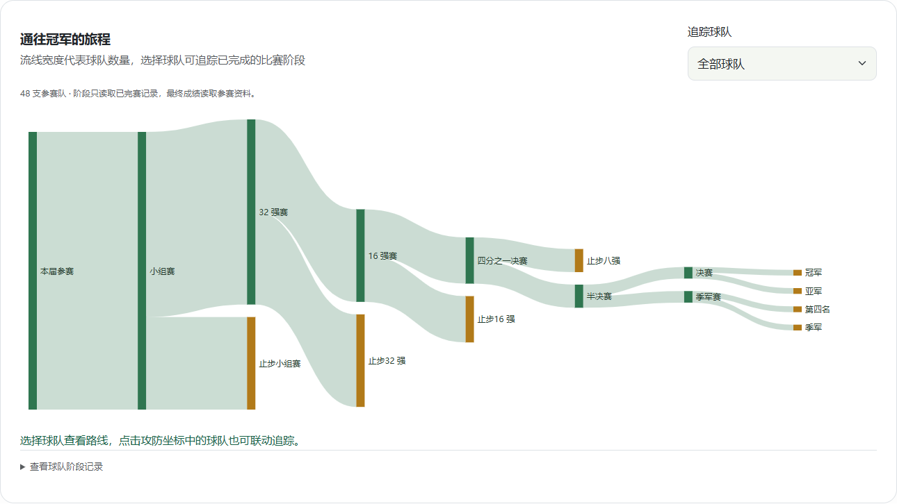

## 使用攻防坐标和比赛日历

1. 在“攻防坐标”中移动指针查看球队数据，或使用“追踪球队”选择器定位球队。越靠右表示场均进球越多，越靠下表示场均失球越少。
2. 选择球队后，在信息卡中点击“查看球队”“比较这支球队”或“查看比赛历程”。
3. 打开“比赛日历”，按月份查看日期。颜色越深表示当天比赛越多；点击有比赛的日期查看当天赛事。
4. 从日期结果打开比赛详情。切换日期或清除筛选后，再核对当前展示的比赛数量。

日历按北京时间归日并排除取消比赛。某天没有完赛记录时，进球统计可能显示“暂无”，不表示当天所有比分均为 0。

场均攻防数据仅针对有完赛记录的球队。图表不显示时，确认浏览器已启用 JavaScript，并刷新页面。

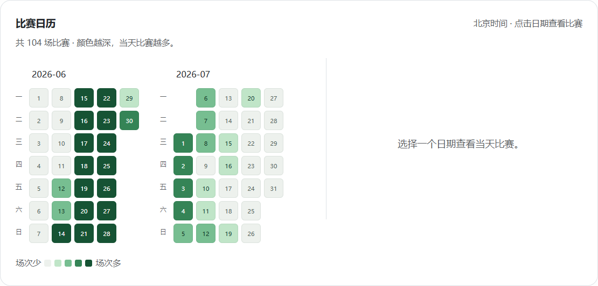

## 制作并导出纪念卡

1. 点击“纪念卡片”，先选择球队，等待比赛列表更新，再选择该队的一场比赛。正常启用 JavaScript 时会自动更新预览，不需要另点确认按钮。
2. 在“一句感想”输入文字，最多 100 字。预览会显示当前选择的球队、比赛与感想。
3. 可选“添加照片”，支持 JPG、PNG、WebP，单张不超过 5 MB。需要撤销时，点击“移除照片”。
4. 确认预览内容正确后，点击“下载 PNG 纪念卡 ↓”，在浏览器下载列表中找到图片并打开检查。

尚未选择有效球队和比赛或预览正在加载时，下载按钮不可用。等预览更新后再导出；页面出现“确认选择”按钮时，可按提示提交选择。

刷新或关闭页面前先导出图片；网站不提供个人纪念卡账户或历史草稿箱。使用自己的图片或已获许可的图片。

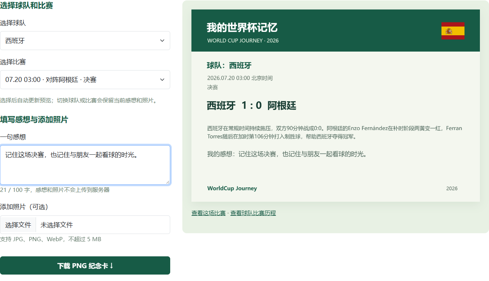

## 提交球迷留言

1. 点击“球迷留言”，找到“写留言”，填写昵称和留言正文。昵称最多 50 字，留言最多 2000 字。
2. 需要关联具体比赛时，在“关联比赛（可选）”选择比赛；也可以按日期筛选。无需关联时保留“不关联比赛”。
3. 点击“提交留言”。出现“留言已提交，审核通过后将公开显示”表示提交成功，此时尚未公开。
4. 审核通过后，在“看台留言”区域查看内容和管理员回复；从比赛页面进入留言时，注意检查预选的关联比赛。

提交成功后暂时看不到自己的留言，通常是等待审核，不必重复提交。审核被拒绝的内容不会公开显示。

当前访客界面没有登录后自助编辑或删除留言的入口。内容需要更正时，请联系网站管理员。

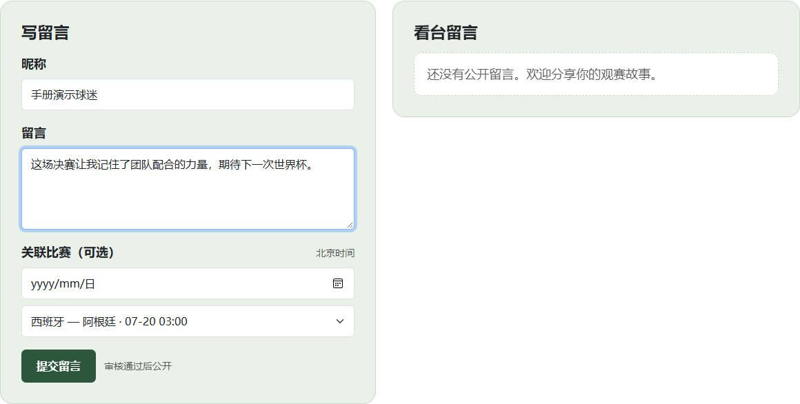

## 查看团队和下载作业

1. 点击顶部或页脚的“关于我们”，阅读团队介绍及四位成员的负责方向。
2. 点击成员卡片进入其个人作业页面，核对页面标题中的成员姓名。
3. 选择需要的作业文件并点击下载入口，使用浏览器下载列表打开保存的文件。ZIP 文件需解压后查看其中内容。
4. 返回“关于我们”，在“团队作业”区域查找团队资料。下载前核对文件标题，避免把不同成员或不同作业混淆。

显示“个人作业待上传”表示当前成员尚无公开登记的文件。网站不会从其他成员名下自动替代下载。

文件通过网站受控入口下载，保存后保留原始文件名。下载失败时刷新页面重试，持续失败请管理员检查文件登记和存储。

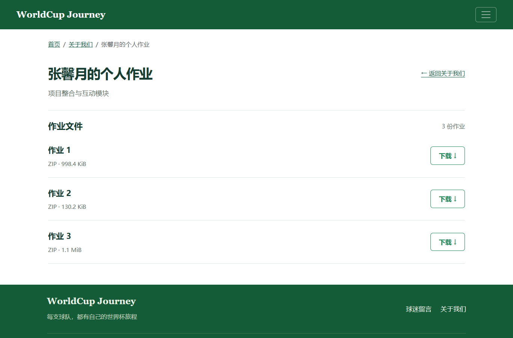

## 登录和退出管理后台

1. 点击网站的“管理员登录”，或在当前站点打开 index.php?r=auth/login。
2. 输入实际分配的管理员账号和密码，点击“登录工作台 →”。登录成功后进入管理概览。
3. 首次部署且管理员表为空时，启动程序会创建管理员，并在终端显示一次随机密码。已有账号时继续使用原账号，不要把 MySQL 密码当作网站登录密码。
4. 维护完成后使用后台顶部的退出操作结束登录。多人共用电脑时，退出后关闭后台页面。

登录失败时检查大小写、输入法及账号状态。无法恢复访问时，请由部署或维护人员按项目管理流程处理。

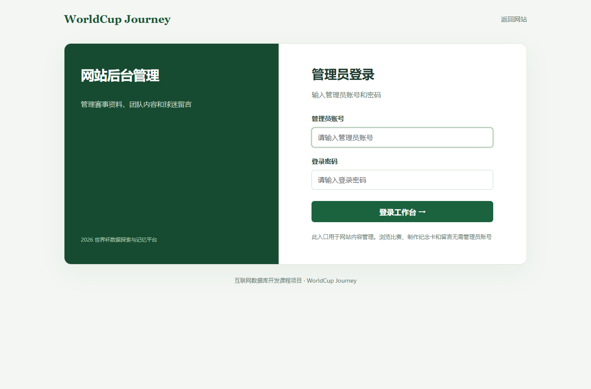

## 审核留言并发布回复

1. 进入“留言审核”，按昵称、正文和关联比赛确认要处理的留言。
2. 确认适合公开后点击“通过审核”；不适合公开时点击“拒绝显示”。页面出现“审核状态已更新”后检查状态标记。
3. 留言通过后，在“回复这条留言”填写 1 至 2000 字的内容，点击“发布回复”。
4. 点击“查看公开留言”，核对留言及管理员回复已在前台显示。需要撤下留言时，可将状态改为拒绝显示。

待审核和已拒绝的留言不能发布回复。同一条留言只能创建一条管理员回复，已有回复时不再显示新增回复表单。

后台留言卡片的提交时间标注为 UTC，阅读时按页面标注理解，不应与前台赛程的北京时间混用。

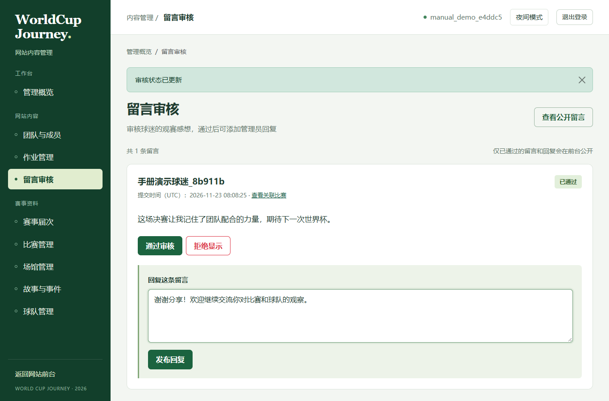

## 维护球队与参赛档案

1. 进入“球队管理”，查找目标球队并打开详情。点击“修改球队”，维护名称、FIFA 代码、国旗路径、说明及状态等页面提供的字段。
2. 在球队详情的“参赛信息”选择小组与最终成绩，点击“保存参赛信息”；尚未登记的记录使用“登记参赛”。
3. 点击“维护 2026 球队档案”，维护简介、教练、三位代表球员及资料来源。按表单要求填写不同的球员、有效位置和号码后保存。
4. 返回前台球队详情，检查名称、档案和统计显示。修改人物身份后，原匹配照片可能自动不再显示，应另行核对图文资料。

完整 26 人增强名单及逐图署名由固定版本资料文件提供，不是这个后台表单中的在线全名单编辑器。更新名单版本应由维护人员统一核对后交付。

有参赛、比赛或事件引用的球队不能直接删除。需要暂时停止展示时，可在修改页面按实际需要停用球队。

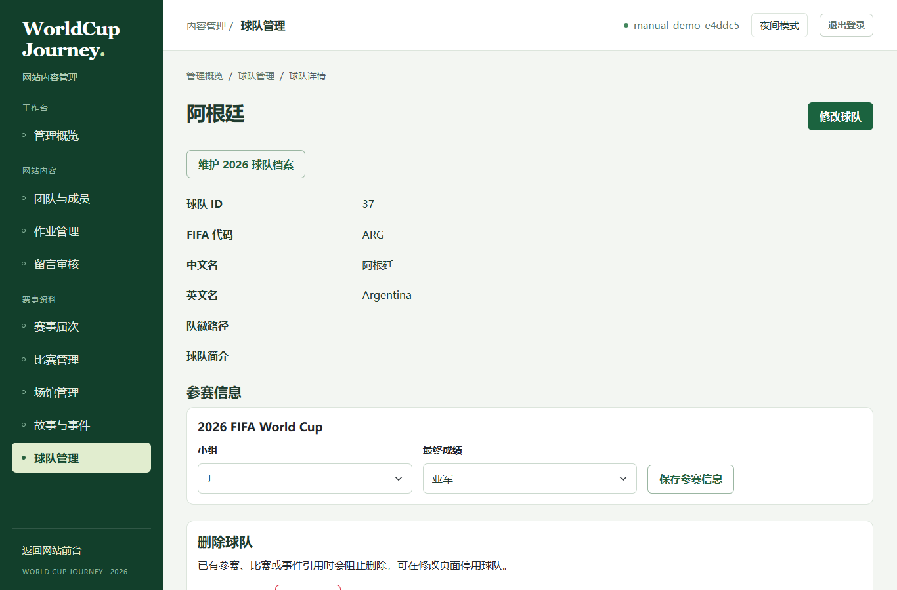

## 维护赛事届次和场馆

1. 进入“赛事届次”，从列表打开现有赛事，或使用新增入口。填写年份、名称、开始和结束日期及说明，点击“保存赛事”。
2. 进入“场馆管理”，查找目标场馆，使用新增或修改入口维护名称、城市、国家代码和时区。
3. 国家代码按场馆所在国选择加拿大 CA、墨西哥 MX 或美国 US。时区可留空；填写时使用类似 America/Toronto 的有效时区名称，再点击“保存场馆”。
4. 保存后从场馆列表或关联比赛详情核对显示。有比赛引用的场馆，删除时可能被系统阻止，应先确认关联关系。

场馆所在时区与数据库中比赛开赛时间的填写口径是不同字段。比赛管理中的 kickoff_utc 仍应按 UTC 输入。

具体必填项以当前表单标记和保存错误提示为准。地图位置来自项目维护的场馆资料，当前场馆表单没有经纬度在线编辑项。

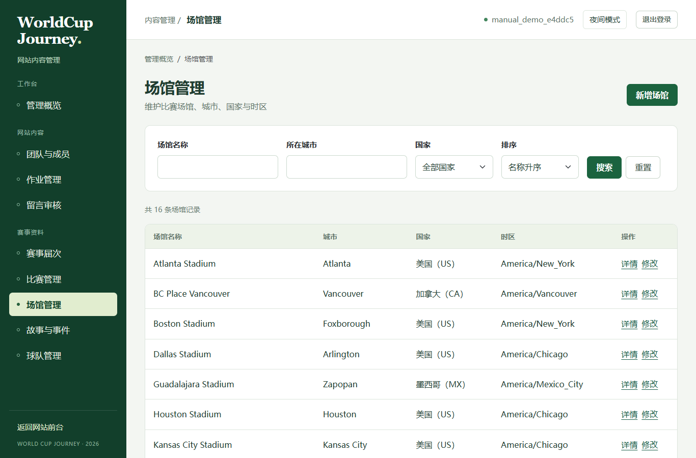

## 维护比赛赛程和比分

1. 进入“比赛管理”，打开目标比赛并修改，或使用新增入口。核对比赛编号、主客队 ID、场馆 ID、阶段和状态。
2. 球队与场馆字段填写数据库 ID，不能填 ARG 等代码或比赛编号。开赛时间按 YYYY-MM-DD HH:MM:SS 格式填写 UTC；小组代码仅用于小组赛。
3. 90 分钟、120 分钟和点球比分各自成对填写。120 分钟是累计值；未开始、延期或取消的比赛不填赛果，已完赛须填 90 分钟比分。
4. 小组赛不填获胜方；已结束淘汰赛填写本场获胜球队 ID。核对后点击“保存比赛”，再检查前台比赛详情及相关统计。

例如北京时间 2026-07-20 03:00，对应 UTC 2026-07-19 19:00；录入前完成时区换算，不能把北京时间原样填入 UTC 字段。

应区分“未发生”和“0”：没有加时或点球时不要随意填 0∶0。系统报错时依照提示修正状态、比分和胜者间的冲突。

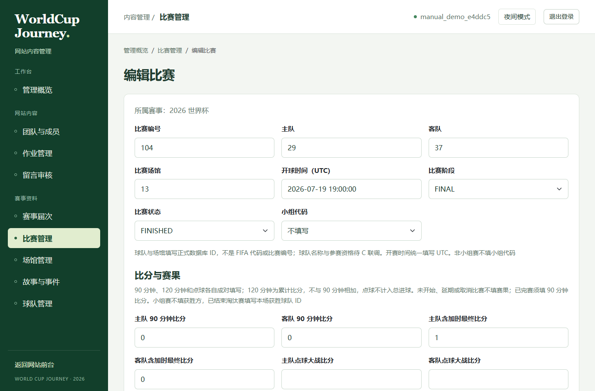

## 维护精选故事和事件

1. 进入“故事与事件”，打开故事详情。点击“修改故事”，维护比赛 ID、标题、摘要、正文、封面相对路径及来源链接。
2. 比赛 ID 取自比赛详情链接中的 id，与赛事内比赛编号不同；一场比赛最多关联一篇故事。正文使用纯文本并保留换行。
3. 通过“管理事件时间轴”维护事件时间、类型、球队、球员及说明；通过“管理标签”维护故事标签及关联，保存后检查详情。
4. 发布前核对事实、来源与素材许可。在编辑页勾选发布选项并按页面要求确认；暂不公开时取消勾选并保存为未发布。

封面字段使用已准备的站内相对路径，不是上传外部图片链接的入口。素材来源和使用条件应与实际文件对应。

新增或修改事件后，应检查时间顺序及与比分的对应关系。部分图表依赖完整事件记录，不能仅凭故事已发布判断图表必然出现。

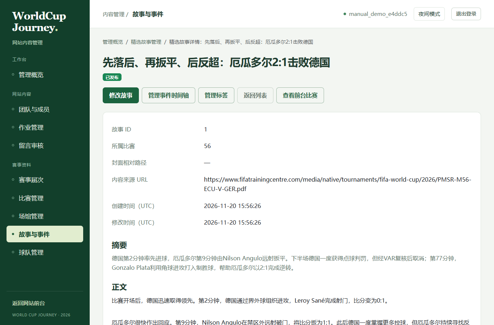

## 维护团队和成员资料

1. 进入“团队与成员”，在目标团队使用“管理资料”进入团队详情。
2. 点击“编辑团队”，修改团队名称、简介或表单提供的图片路径，保存后返回详情。
3. 在成员行点击“编辑”，维护姓名、负责方向、具体分工与显示顺序。需要新增时使用“新增成员”，并确认所属团队。
4. 返回前台“关于我们”检查显示。显示顺序的数字越小，成员越靠前；资料更正不需要重新上传已有作业。

已关联个人作业的成员不能直接删除；团队有关联成员或作业时也不能直接删除。不要为调整顺序而删除并重建成员。

团队图片字段可留空；使用图片时先准备站内文件，再填写类似 images/team/logo.png 的相对路径。

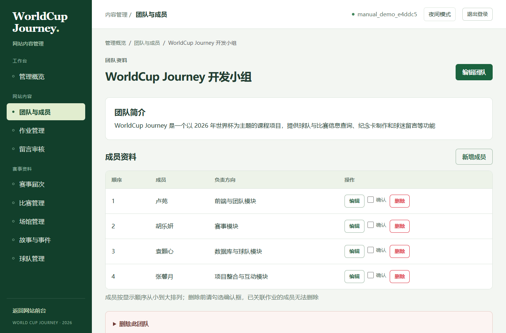

## 上传和替换课程作业

1. 进入“作业管理”，点击“上传作业”，填写作业标题并选择作业类型和所属团队。
2. 团队作业的所属成员留空；个人作业必须选择该团队中的对应成员。选择文件后点击“保存作业”。
3. 单文件不超过 20 MB，支持表单列出的 PDF、Office、ZIP、Axure RP、图片与文本等类型。文件不被接受时，按错误提示核对格式和大小。
4. 需要替换时，在列表点击“编辑”。不选择新文件会保留当前文件；选择新文件后保存会替换。保存后到前台核对归属并实际下载一次。

类别、团队和成员必须相互匹配。不要把成员姓名仅写在标题里而遗漏“所属成员”的选择。

删除前需要勾选确认框；删除后前台不再提供该文件。替换或删除前，维护人员应保留所需的原稿备份。

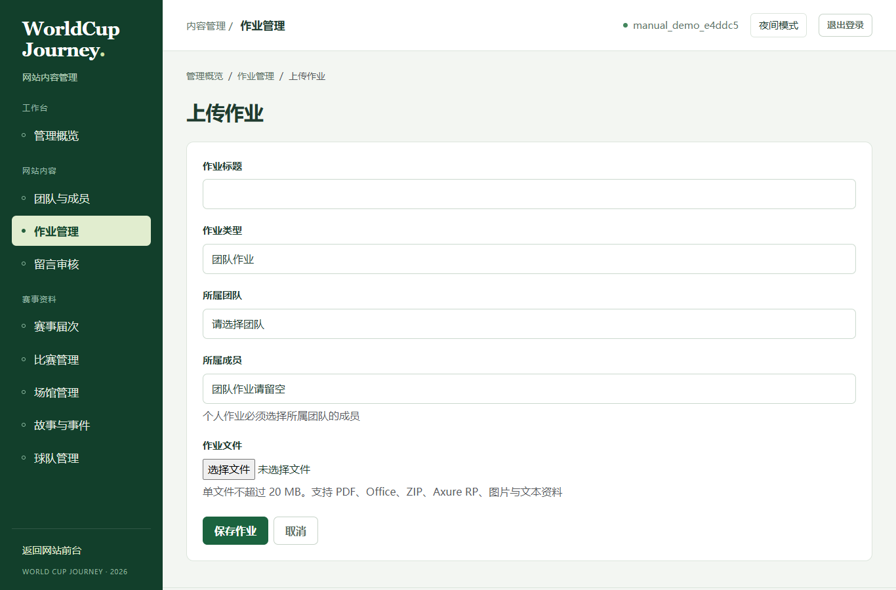

## 常见问题与数据含义


| 现象 | 处理方法 |
| --- | --- |
| 地址无法打开 | 确认启动终端仍在运行，使用 Ready at 显示的地址；8080 不可用时，以实际分配端口为准。 |
| 图表空白或纪念卡不更新 | 启用 JavaScript，刷新页面；纪念卡选好球队和比赛后等待自动更新，图表还需有效赛事记录。 |
| 纪念卡不能下载 | 检查已确认比赛、预览已生成，以及可选图片格式和 5 MB 限制；再检查浏览器下载列表。 |
| 提交留言后没有公开 | 看到提交成功提示后等待审核。只有已通过的留言公开，避免重复提交。 |
| 有比分但没有故事 | 该场可能没有已发布故事；事件或走势也取决于相关记录的完整程度。 |
| 个人作业页面没有文件 | 确认打开的是正确成员；请管理员检查文件是否已登记、类型与成员归属是否正确。 |
| 管理员保存失败 | 查看表单错误提示，重点核对必填项、关联 ID、比分状态及作业归属。 |
| 登录失效或表单过期 | 重新打开页面；需要时重新登录，保留待填内容后再提交。不要反复发送旧表单。 |

比赛时间与日期：前台赛程、球队旅程和比赛日历按北京时间展示；比赛后台按 UTC 录入。后台留言时间另有 UTC 标注，以页面标签为准。

名单与统计：固定 FIFA 名单中的国家队累计场次和进球，不等于本届表现。照片是标明年份的资料照，俱乐部按资料版本而非照片球衣判断。
